# CampusFlow

<p align="center">
  <strong>Your Future. In Motion.</strong><br>
  <em>A Full-Stack Campus Recruitment & Career Intelligence Platform</em>
</p>

<p align="center">
  <strong>Problem Statement:</strong> HACK-P410 — Campus Recruitment Management Portal<br>
  <strong>Target Audience:</strong> University Students &bull; Corporate Recruiters &bull; Placement Cell Deans & Administrators<br>
  <strong>System Architecture:</strong> React 18 + TypeScript + Vite + Supabase (PostgreSQL 15+) + Groq LPU™ AI Cloud
</p>

<p align="center">
  
  
  
  
  
  
  
</p>

---

## Table of Contents

- [1. Executive Summary & Problem Context](#1-executive-summary--problem-context)
- [2. Architectural Highlights & Engineering Innovations](#2-architectural-highlights--engineering-innovations)
- [3. Feature Matrix & Implementation Status](#3-feature-matrix--implementation-status)
- [4. Three-World User Experience](#4-three-world-user-experience)
- [5. Visual Workstation Tour](#5-visual-workstation-tour)
- [6. System Architecture](#6-system-architecture)
- [7. Complete PostgreSQL Database Documentation](#7-complete-postgresql-database-documentation)
- [8. Authentication & Authorization Architecture](#8-authentication--authorization-architecture)
- [9. Deterministic Recruitment Workflow & State Machine](#9-deterministic-recruitment-workflow--state-machine)
- [10. Deterministic Eligibility Engine](#10-deterministic-eligibility-engine)
- [11. Groq LPU™ Resume Intelligence Pipeline](#11-groq-lpu-resume-intelligence-pipeline)
- [12. Backend API, RPC & Edge Functions Reference](#12-backend-api-rpc--edge-functions-reference)
- [13. Role-Specific Purposeful Analytics](#13-role-specific-purposeful-analytics)
- [14. Security Architecture & Threat Model](#14-security-architecture--threat-model)
- [15. Verification, Testing & Quality Gates](#15-verification-testing--quality-gates)
- [16. Local Development Quickstart](#16-local-development-quickstart)
- [17. Supabase Cloud Deployment Runbook](#17-supabase-cloud-deployment-runbook)
- [18. Google OAuth Setup](#18-google-oauth-setup)
- [19. Project Structure](#19-project-structure)
- [20. Development Roadmap](#20-development-roadmap)
- [21. Contributing & License](#21-contributing--license)

---

## 1. Executive Summary & Problem Context

Collegiate campus recruitment is one of the most critical inflection points in higher education, yet it remains one of the most operationally fragile processes within universities worldwide.

### The Conventional Placement Crisis
- **Information Fragmentation:** Job openings, job descriptions (JDs), deadlines, and criteria are scattered across unorganized email threads, WhatsApp broadcast groups, and physical bulletin boards.
- **Manual, Flawed Screening:** Placement officers and recruiters manually cross-reference student spreadsheets against eligibility criteria, leading to administrative delays and student disqualifications caused by clerical errors.
- **Recruitment Status Uncertainty:** Students submit applications into an informational black hole, with zero visibility into whether their application is under review, shortlisted, or scheduled for technical assessment.
- **Interview Coordination Friction:** Scheduling multiple rounds across competing companies results in overlapping slots, uncoordinated video conference links, and missed opportunities.
- **Compromised Reporting:** Institutional accreditation bodies (e.g. NAAC, NIRF) require precise placement statistics, but spreadsheet-driven records suffer from double-counting students who hold multiple offers or who were placed off-campus.

### The CampusFlow Solution
**CampusFlow** transforms collegiate recruitment from a chaotic administrative chore into a high-density, transparent, and secure digital ecosystem. Built on **Supabase (PostgreSQL 15+)** and powered by **Groq LPU™ AI Acceleration**, CampusFlow provides a unified workstation for students, corporate recruiters, and university placement administrators.

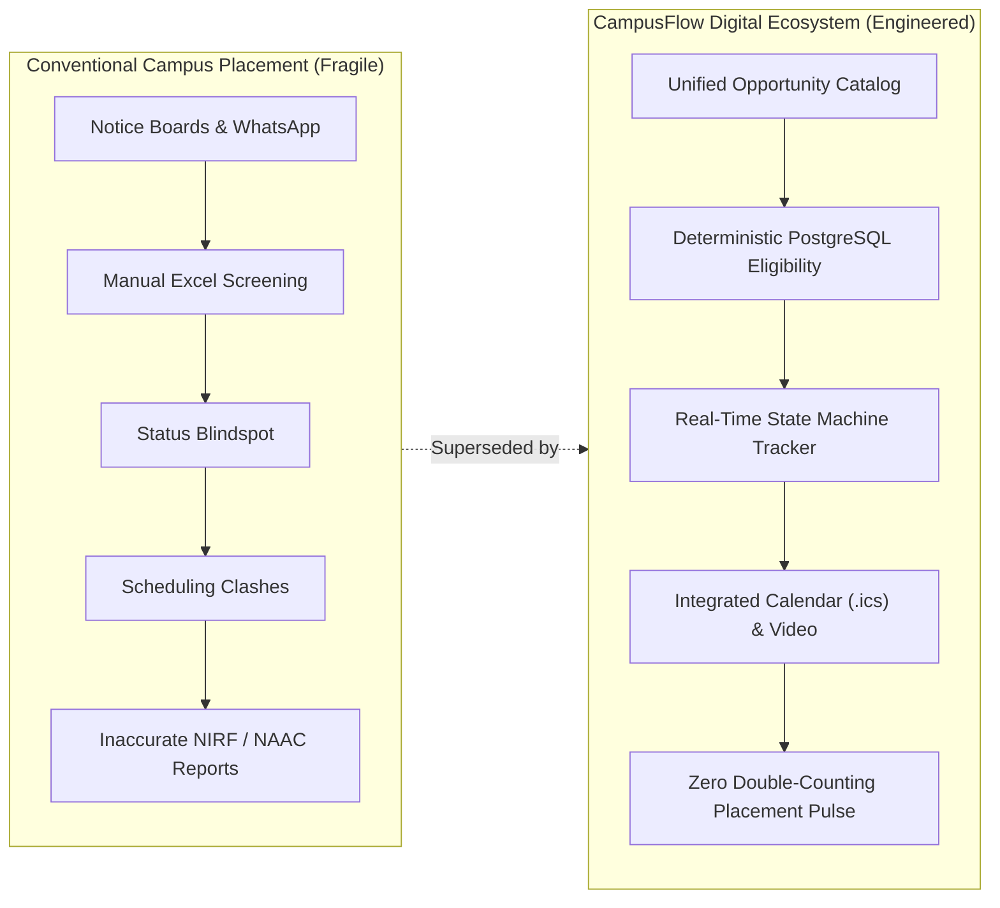

---

## 2. Architectural Highlights & Engineering Innovations

1. **Deterministic Eligibility Engine:** Server-side PostgreSQL RPC (`evaluate_job_eligibility`) authoritatively enforces CGPA thresholds, allowable academic branches, active backlogs, and graduation batches. Client-side state cannot falsify qualification.
2. **Atomic Application Submission:** The `submit_application` PostgreSQL stored procedure runs inside a single atomic transaction that evaluates eligibility, checks expiry deadlines, prevents duplicate submissions via database constraints, creates the application record, logs the initial audit trail, and generates an in-app notification.
3. **Rigid Recruitment State Machine:** Candidate stage transitions (`submitted` → `shortlisted` → `interview` → `selected` / `rejected`) are guarded by database triggers. Terminal states (`selected`, `rejected`, `withdrawn`) are strictly protected from tampering.
4. **Groq LPU™ Resume Intelligence:** Technical resume parsing using `pdf-parse` and Groq's LPU™ cloud (`openai/gpt-oss-120b`). Resume text is isolated as untrusted data, redacted of PII, validated through strict `zod` schemas, and matched against live Supabase jobs.
5. **Non-Negotiable Row Level Security (RLS):** 100% of exposed application tables are protected by multi-role RLS policies using non-recursive `SECURITY DEFINER` helper functions (`is_admin()`, `is_recruiter_for_company()`, `is_recruiter_for_student_resume()`).
6. **Zero Double-Counting Analytics:** Database aggregation via `get_placement_analytics()` mathematically guarantees:
   $$\text{Total Enrolled Students} = \text{Placed Candidates} + \text{In-Process Candidates} + \text{Unplaced Candidates}$$
7. **Offline Demo Sandbox:** When cloud credentials are not linked, the application seamlessly activates an authenticated demo mode supporting Student (`Aarav Sharma`), Recruiter (`Priya Nair`), and Placement Administrator (`Dr. Rajesh Rao`) without runtime exceptions or UI breakage.

---

## 3. Feature Matrix & Implementation Status

To maintain total transparency, every capability in the repository is explicitly classified:

| Functional Area | Capability | Status | Implementation Details |
|---|---|:---:|---|
| **Student Experience** | Opportunity Discovery | **IMPLEMENTED** | Multi-faceted search by title, company, work mode, and employment type. |
| | Explainable Eligibility Engine | **IMPLEMENTED** | Live breakdown showing qualification status across CGPA, branch, backlogs, and batch. |
| | What-If Eligibility Lab | **IMPLEMENTED** | Interactive simulation sliders (CGPA, backlogs, department) with qualification matrix. |
| | Opportunity Watchlist | **IMPLEMENTED** | Bookmark drives with deadline radar (<48h pulsing red, <7d amber). Hybrid DB + LocalStorage sync. |
| | Application Tracking | **IMPLEMENTED** | Real-time stage progression (`Submitted` → `Shortlisted` → `Interview` → `Selected`). |
| | Application Status Audit Trail | **IMPLEMENTED** | Immutable chronological ledger showing previous stage, new stage, author, and reason. |
| | Voluntary Withdrawal | **IMPLEMENTED** | Safe withdrawal allowed only from `submitted` or `shortlisted` stages via RPC. |
| | Student Interview Workstation | **IMPLEMENTED** | Scheduled rounds, Google Meet links, notes, and RFC 5545 `.ics` calendar download. |
| | Career Compass Radar | **IMPLEMENTED** | Context-aware dashboard widget surfacing urgent interviews, profile gaps, and closing drives. |
| | Student Profile Management | **IMPLEMENTED** | Academic standing, skills tag cloud, project portfolio, and private resume upload. |
| **Recruiter Experience** | Candidate ATS Table | **IMPLEMENTED** | Filter applicants by job, status, branch, and CGPA with inline action triggers. |
| | Candidate Compare Matrix | **IMPLEMENTED** | Side-by-side comparison modal for up to 3 selected candidates (CGPA, skills overlap, resume). |
| | Job Posting Creation & Manager | **IMPLEMENTED** | Create and publish campus openings with compensation ranges and eligibility rules. |
| | Interview Scheduling | **IMPLEMENTED** | Schedule virtual or in-person evaluation rounds; automatically advances application to `interview`. |
| | Recruiter Conversion Funnel | **IMPLEMENTED** | Recharts `ChartFunnel` tracking candidate throughput across pipeline stages. |
| | Recruiter Company Profile | **IMPLEMENTED** | Manage company overview, industry classification, website, and branding assets. |
| **Admin Experience** | Executive Command Center | **IMPLEMENTED** | Placement Pulse KPIs, active drives, partner companies, and recent activity feed. |
| | Student Directory | **IMPLEMENTED** | University-wide student records with academic filters and placement status badges. |
| | Company Empanelment | **IMPLEMENTED** | Manage corporate partners, industry sectors, and empanelment approvals. |
| | Recruiter Access Management | **IMPLEMENTED** | Provision recruiter credentials, associate company memberships, and revoke access. |
| | Recruitment Drives Scheduler | **IMPLEMENTED** | Create, schedule, and monitor campus-wide placement seasons. |
| | Placement Pulse Analytics | **IMPLEMENTED** | Placement rate donut, department-wise horizontal conversion bars, CTC tiers, zero double-counting. |
| | NIRF / NAAC Report Exporter | **IMPLEMENTED** | Generate and export institutional accreditation compliance placement reports (`AdminReports.tsx`). |
| **AI Intelligence** | PDF Text Extraction | **IMPLEMENTED** | Native stream extraction via `pdf-parse` with empty/scanned PDF detection. |
| | PII Redaction & Sanitization | **IMPLEMENTED** | Automatic redaction of phone numbers and emails; truncation to 12k chars for prompt security. |
| | Groq LPU™ Structured Analysis | **IMPLEMENTED** | Server-side inference via `openai/gpt-oss-120b` validated with `zod` schema. |
| | Dual-Score Job Matching | **IMPLEMENTED** | Distinguishes AI Resume Suitability % from Authoritative Academic Cutoff Eligibility. |
| | Analysis Persistence & Cache | **IMPLEMENTED** | SHA-256 document hashing with persistence to `public.resume_analyses`. |
| | Scanned Image-Only OCR | **PARTIALLY IMPLEMENTED** | Scanned/image-only PDFs trigger clear user warning `SCANNED_OR_EMPTY_PDF` requesting text PDF. |
| **Identity & Security** | Email & Password Auth | **IMPLEMENTED** | GoTrue v2 authentication with secure password reset workflows. |
| | Google OAuth SSO | **IMPLEMENTED** | Complete OAuth 2.0 flow with token exchange in `AuthCallbackPage.tsx`. |
| | Role-Based Access Control | **IMPLEMENTED** | Database-level role protection; public registration restricted to `student`. |
| | Private Resume Storage | **IMPLEMENTED** | 5MB PDF-only Supabase Storage bucket with signed URL generation for authorized recruiters. |
| | Anti-Escalation Triggers | **IMPLEMENTED** | Intercepts unauthorized updates to `profiles.role` or `student_profiles` academic metrics. |
| | In-App Notifications | **IMPLEMENTED** | Real-time notifications for application submissions, status updates, and interviews. |
| | WhatsApp / SMS Webhooks | **PLANNED** | External SMS/WhatsApp gateway webhooks for interview reminders. |
| | Multi-University Partitioning | **PLANNED** | Multi-tenant SaaS architecture supporting multiple independent universities. |

---

## 4. Three-World User Experience

CampusFlow provides tailored workspaces tailored specifically to each recruitment stakeholder:

```
                                  +---------------------------------------------------+
                                  |              CampusFlow Platform Shell            |
                                  +---------------------------------------------------+
                                            /                  |                  \
                                           /                   |                   \
                                          v                    v                    v
                        +--------------------+  +--------------------+  +--------------------+
                        | Student Workspace  |  | Recruiter ATS      |  | Admin Command      |
                        +--------------------+  +--------------------+  +--------------------+
                        | Career Compass     |  | Pipeline ATS       |  | Placement Pulse    |
                        | Explore Drives     |  | Candidate Compare  |  | Recruiter Access   |
                        | What-If Lab        |  | Post Openings      |  | Drive Scheduling   |
                        | Resume AI          |  | Schedule Rounds    |  | NIRF/NAAC Reports  |
                        | Watchlist          |  | Funnel Analytics   |  | Student Directory  |
                        +--------------------+  +--------------------+  +--------------------+
```

### Role Comparison Matrix

| Dimension | Student Workspace | Corporate Recruiter ATS | Placement Administrator |
|---|---|---|---|
| **Primary Goal** | Discover, qualify for, and secure top career opportunities. | Identify, evaluate, and hire top campus talent with zero noise. | Maximize institutional placement rate and ensure fair process. |
| **Core Screens** | Dashboard, Opportunities, Watchlist, What-If Lab, Applications, Interviews, Resume Intelligence, Profile. | Dashboard, Jobs Manager, Applicant ATS, Candidate Compare, Interviews, Company Profile, Analytics. | Command Center, Students, Companies, Recruiters, Drives, Applications, Interviews, Analytics, Reports. |
| **Data Scope** | **Personal Record Only:** Can only view own applications, profile, resume, and active public drives. | **Assigned Company Only:** Can only view postings and candidates who applied to their specific company. | **Campus-Wide:** Supervisory oversight across all students, companies, drives, and institutional metrics. |
| **Key Actions** | Run resume analysis, simulate eligibility, bookmark drives, apply via RPC, download `.ics` calendar invites. | Shortlist candidates, compare up to 3 candidates side-by-side, schedule technical rounds, confirm offers. | Empanel employers, approve recruitment seasons, provision recruiter credentials, export accreditation reports. |
| **Demo Persona** | **Aarav Sharma** (`aarav.sharma@campus.edu`) | **Priya Nair** (`priya.nair@novatech.io`) | **Dr. Rajesh Rao** (`placements@campus.edu`) |

---

## 5. Visual Workstation Tour

All screenshots below represent the **actual working application** captured from the local build:

### Public Landing Page & Student Experience

| Screen | Description |
|:---:|:---|
| 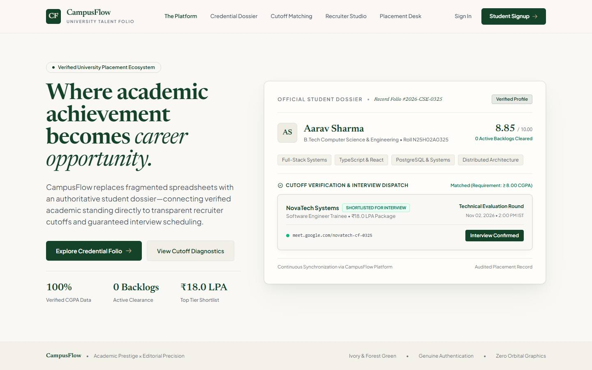 | **Public Portal (Editorial Prestige Direction):** Features the interactive Live Eligibility Simulator, Three Worlds Experience, and Dynamic Role Showcase. |
| 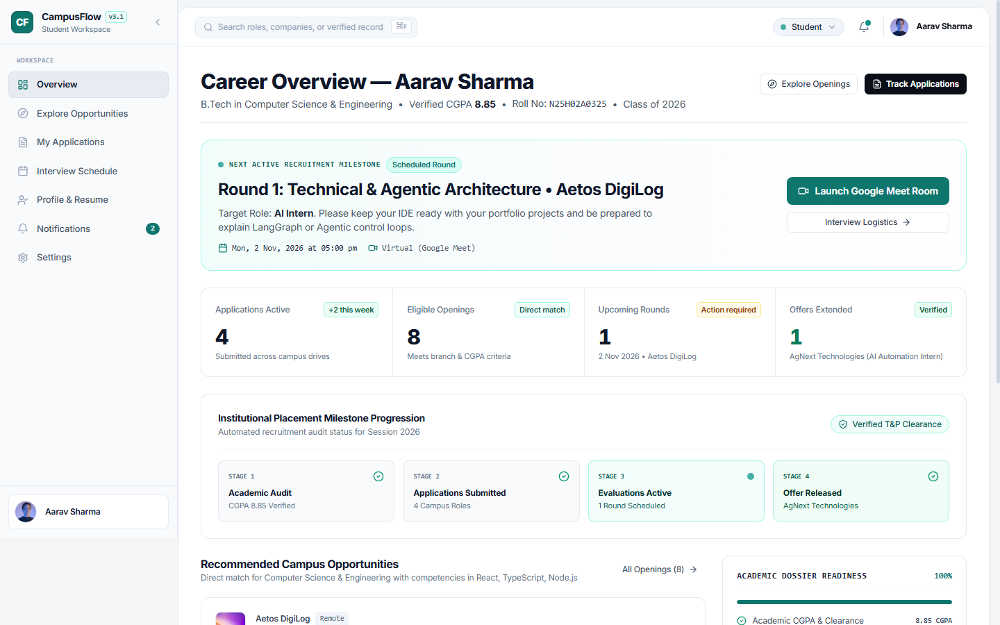 | **Student Dashboard:** Displays the **Career Compass** priority action radar, application stages summary, upcoming interviews, and high-match recommendations. |
| 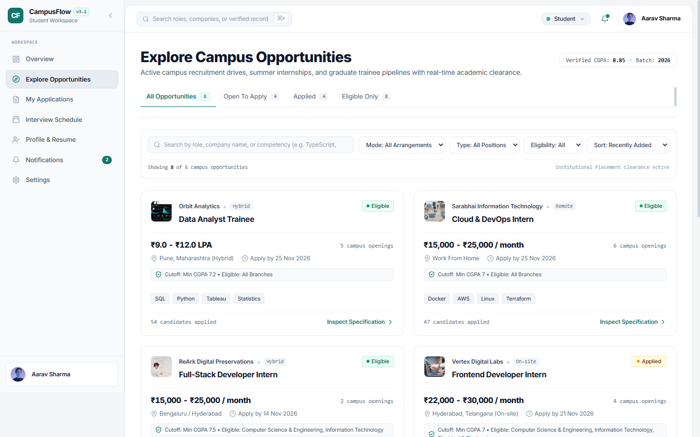 | **Opportunity Catalog:** Searchable job listings featuring dual-badge match indicators (AI Resume Suitability % and Academic Cutoff status) with deadline alerts. |
| 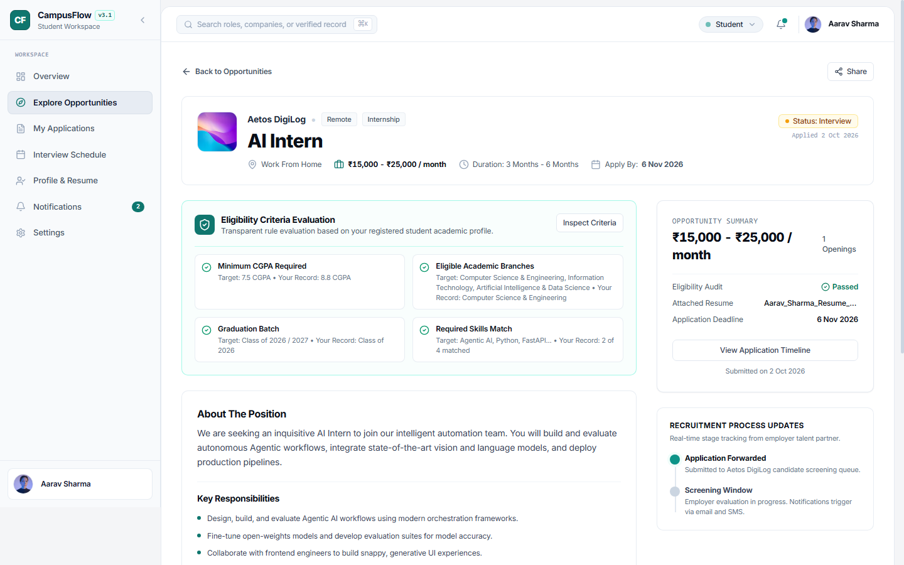 | **Job Details & Explainable Eligibility:** Itemized breakdown of CGPA cutoff, eligible academic departments, standing backlogs, and graduation years with one-click atomic apply. |
| 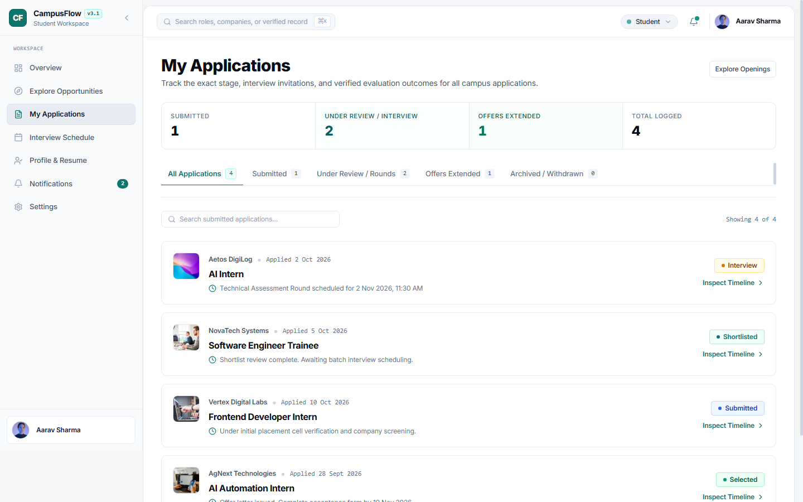 | **Candidate Applications Tracker:** Structured tracking across `Submitted`, `Shortlisted`, `Interview`, `Selected`, and `Rejected` stages with direct details navigation. |
| 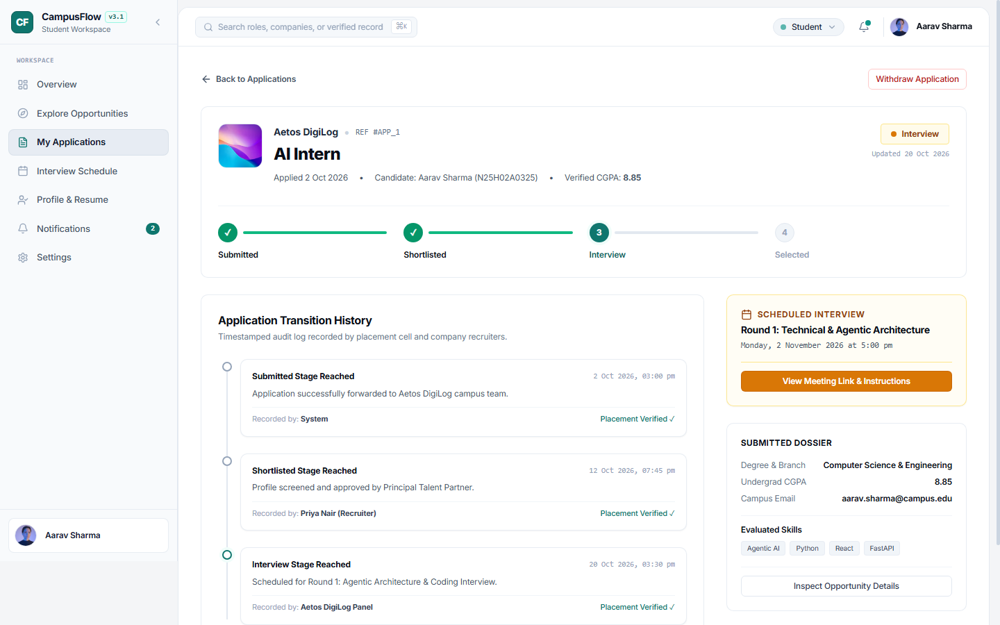 | **Application Stage Audit Ledger:** Chronological timeline showing stage transitions, timestamp, acting authority, and auditor reasoning. |
| 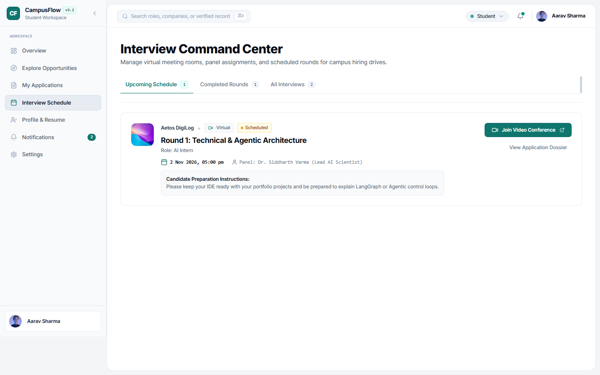 | **Interview Workstation:** Verified interview schedules with round details, Google Meet video links, instructions, and one-click `.ics` calendar sync. |
| 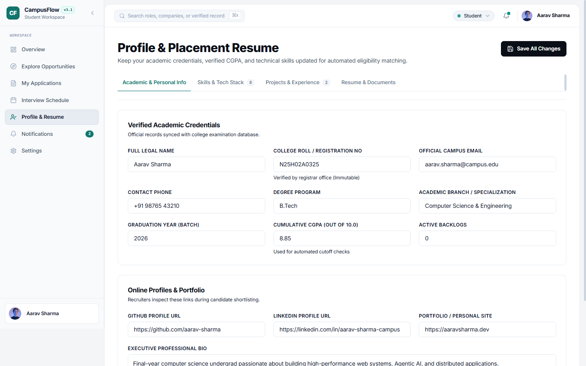 | **Academic Profile & Resume Manager:** Verified university records (Roll No, CGPA, Branch), normalized skills tag cloud, project portfolio, and private PDF upload. |

### Recruiter & Placement Administrator Workstations

| Screen | Description |
|:---:|:---|
| 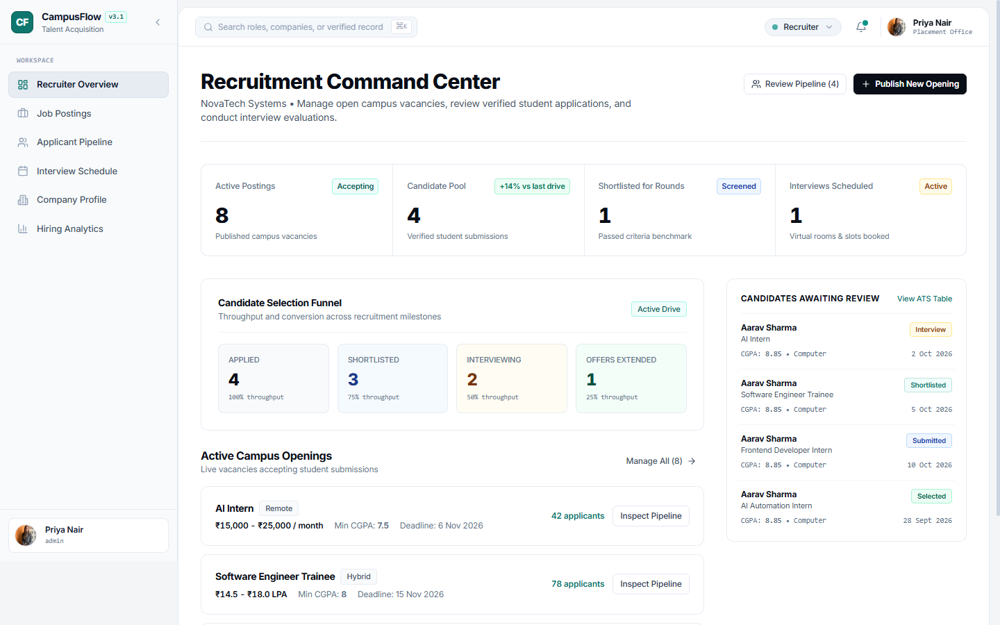 | **Recruiter Dashboard:** Active hiring pipeline overview, applicant stage donut chart, quick actions to create postings, and scheduled interview rounds. |
| 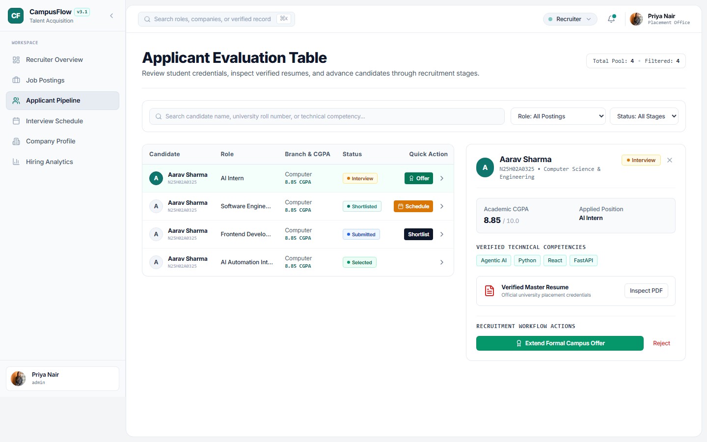 | **Recruiter ATS & Candidate Compare Matrix:** High-density candidate evaluation workstation with checkbox selection to compare up to 3 applicants side-by-side. |
| 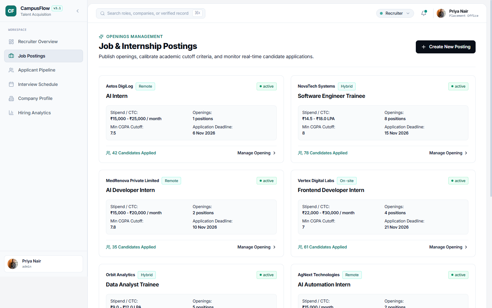 | **Recruiter Job Management:** Manage published campus openings, applicant counts, deadlines, and compensation tiers. |
| 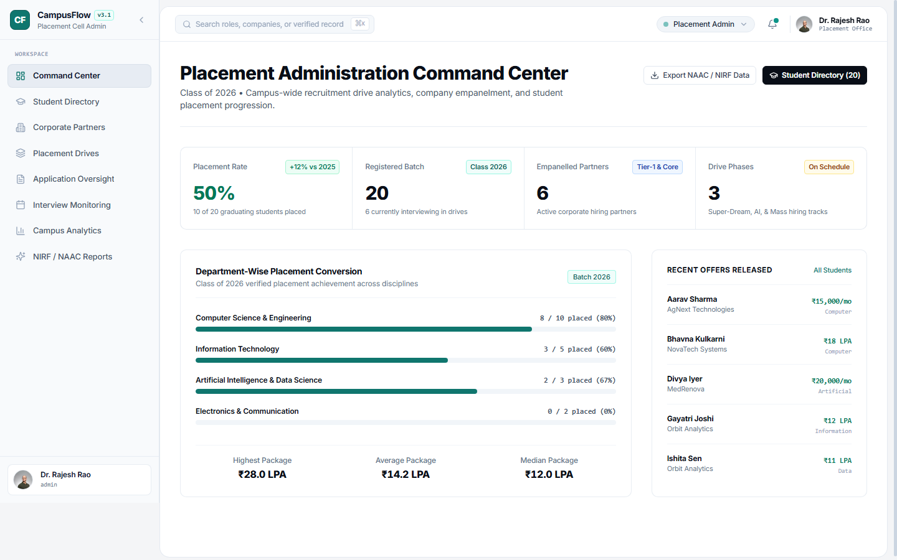 | **Admin Command Center:** Executive overview of university placement operations, active hiring drives, partner organizations, and recent activities. |
| 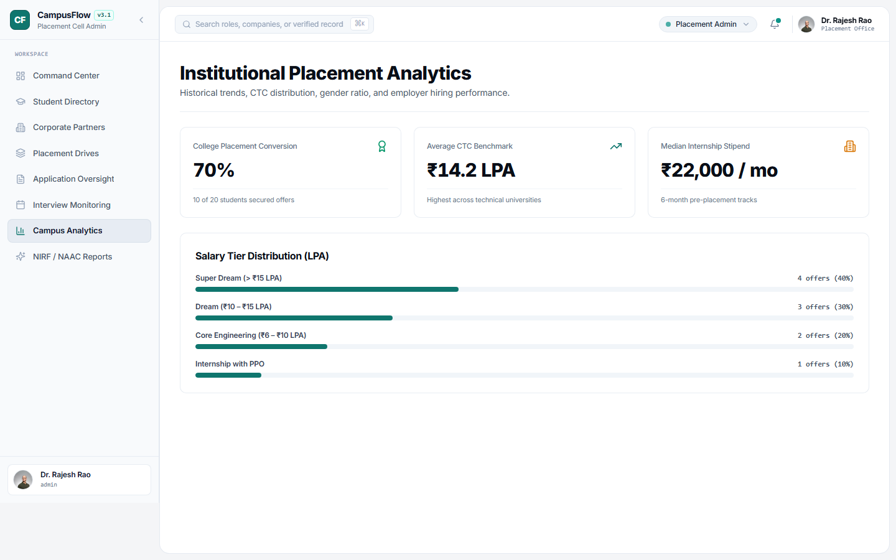 | **Placement Pulse Analytics:** Zero double-counting placement metrics, department-wise horizontal conversion rates, candidate conversion funnels, and CTC distribution. |

### Responsive Mobile Experience

| Mobile Dashboard | Mobile Opportunities Catalog |
|:---:|:---:|
| 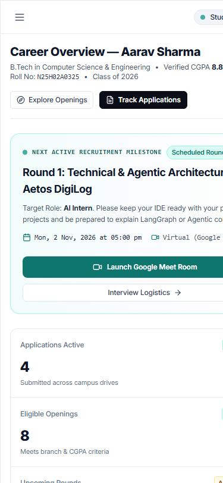 | 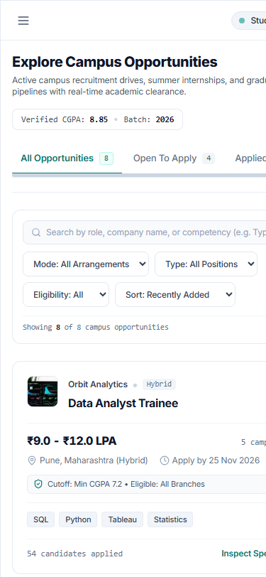 |
| *Adaptive touch-friendly action radar on mobile viewports (375x812)* | *Opportunity discovery cards optimized for mobile candidate evaluation* |

---

## 6. System Architecture

The CampusFlow architecture is organized into clearly separated tiers:

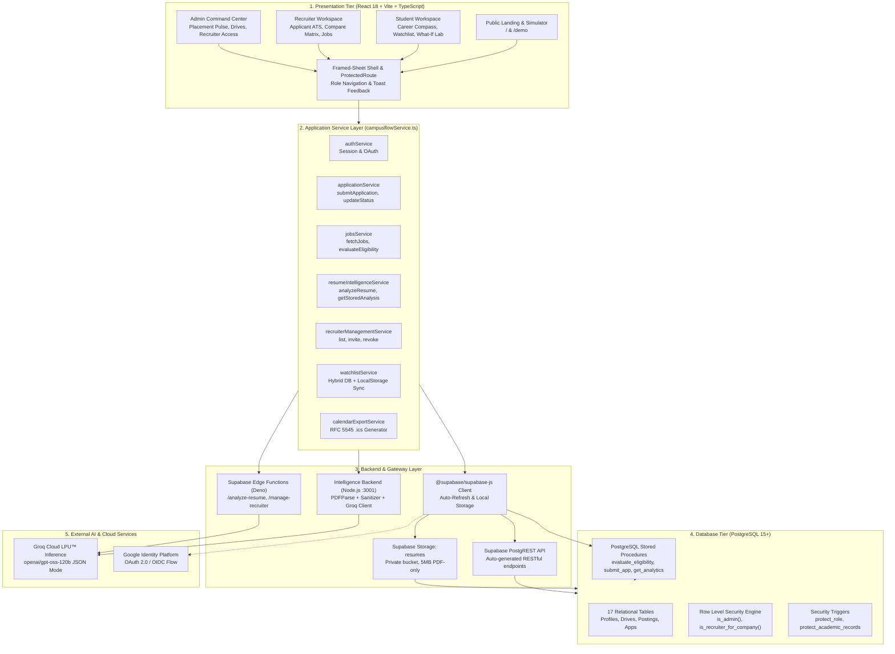

> For deep architectural specifications, see [`docs/ARCHITECTURE.md`](docs/ARCHITECTURE.md).

---

## 7. Complete PostgreSQL Database Documentation

The CampusFlow database consists of **17 normalized relational tables** in PostgreSQL 15+:

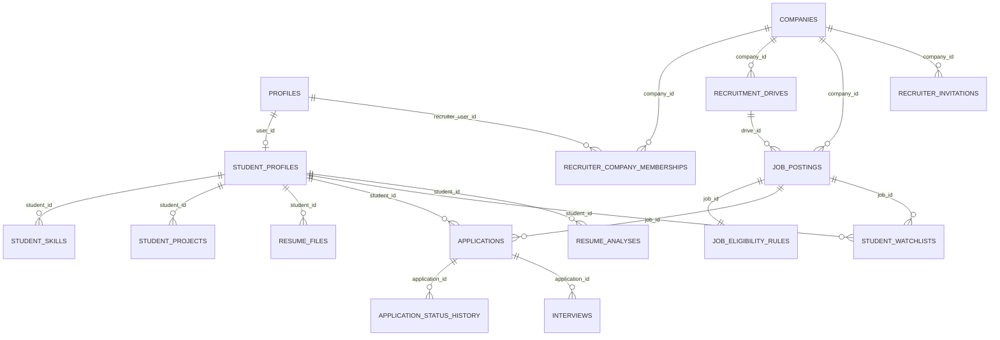

### Table Catalog Summary

| # | Table Name | Purpose | Primary Key | Key Foreign Keys & Constraints | RLS Enforcement |
|---|---|---|---|---|---|
| 1 | `profiles` | Extends `auth.users` with names, roles, avatars | `id (uuid)` | `id` references `auth.users(id)` ON DELETE CASCADE | Users view own; Admin views all; Role mutation guarded |
| 2 | `student_profiles` | Verified academic credentials (CGPA, roll, branch) | `id (uuid)` | `user_id` UNIQUE, `roll_number` UNIQUE, `cgpa (0-10)` | Student views/updates own non-academic; Recruiter reads applicants |
| 3 | `student_skills` | Normalized candidate technical competencies | `id (uuid)` | UNIQUE (`student_id`, `skill_name`) | Student manages own; Recruiter reads applicants |
| 4 | `student_projects` | Showcase portfolio projects and links | `id (uuid)` | `student_id` references `student_profiles(id)` | Student manages own; Recruiter reads applicants |
| 5 | `companies` | Empaneled hiring organizations | `id (uuid)` | `name` UNIQUE, `status` check | Public read for active; Admin manages all |
| 6 | `recruiter_company_memberships` | Binds recruiters to authorized corporate employers | `id (uuid)` | UNIQUE (`recruiter_user_id`, `company_id`) | Recruiter views own; Admin manages all |
| 7 | `recruitment_drives` | University placement hiring seasons | `id (uuid)` | `end_date >= start_date` | Active drives visible to all; Admin manages |
| 8 | `job_postings` | Campus openings, compensation, deadlines | `id (uuid)` | `compensation_max >= compensation_min` | Active visible; Recruiter manages company postings |
| 9 | `job_eligibility_rules` | Machine-evaluated eligibility criteria | `id (uuid)` | `job_id` UNIQUE (1:1 with `job_postings`) | Public read; Recruiter manages own job rules |
| 10 | `applications` | Candidate job submissions | `id (uuid)` | **UNIQUE (`student_id`, `job_id`)** | Student views own; Recruiter views company applicants |
| 11 | `application_status_history` | Immutable audit trail of stage changes | `id (uuid)` | `application_id` references `applications(id)` | Viewable by applicant, recruiter & admin; Insert via RPC |
| 12 | `interviews` | Scheduled evaluation rounds and meeting links | `id (uuid)` | `scheduled_at` in future, status check | Visible to candidate and assigned company recruiter |
| 13 | `notifications` | In-app user notification center | `id (uuid)` | `user_id` index | Users read and update only own notifications |
| 14 | `resume_files` | Metadata for uploaded PDF resumes | `id (uuid)` | `storage_path` UNIQUE | Student owns; Recruiter reads only if student applied |
| 15 | `resume_analyses` | Persisted Groq AI structured evaluations | `id (uuid)` | `student_id` references `student_profiles(id)` | Student views and deletes own; `service_role` writes |
| 16 | `recruiter_invitations` | Recruiter account invitations and provisioning | `id (uuid)` | `email`, `company_id` | Strictly restricted to Placement Administrators |
| 17 | `student_watchlists` | Personalized opportunity bookmarks | `id (uuid)` | UNIQUE (`student_id`, `job_id`) | Student manages own; Admin reads for demand analytics |

> For column-by-column definitions, indexes, triggers, and SQL declarations, see [`docs/DATABASE_SCHEMA.md`](docs/DATABASE_SCHEMA.md).

---

## 8. Authentication & Authorization Architecture

CampusFlow uses **Supabase Auth (GoTrue v2)** for identity lifecycle management, combined with **PostgreSQL Row Level Security** for authorization.

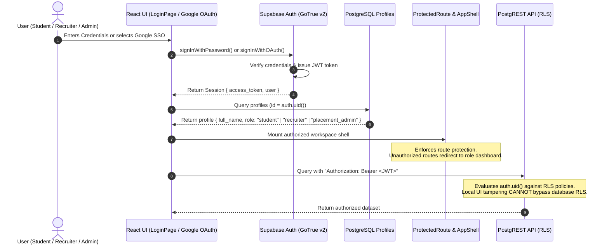

### Security Definer Guardrails
- **Public Signup Lockdown:** All public registrations via `/signup` or Google OAuth trigger `handle_new_user()`, which strictly assigns `role = 'student'`. Privileged roles cannot be self-assigned.
- **Anti-Privilege Escalation:** Trigger `trg_protect_profile_role` prohibits users from modifying their own `profiles.role` column.
- **Academic Standing Immutability:** Trigger `trg_protect_student_academic_records` prohibits students from updating their official CGPA, active backlogs, roll number, or department branch.

> For complete authentication flows and Google OAuth setup, see [`docs/AUTHENTICATION.md`](docs/AUTHENTICATION.md).

---

## 9. Deterministic Recruitment Workflow & State Machine

Candidate applications progress through a deterministic finite-state machine enforced by the PostgreSQL stored procedure `update_application_status`:

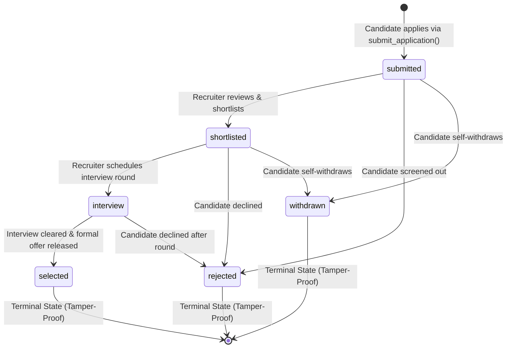

### State Transition Rules
1. **No Pipeline Skipping:** Applications cannot jump directly from `submitted` to `selected`.
2. **Terminal State Protection:** Once an application reaches `selected`, `rejected`, or `withdrawn`, no further status transitions are permitted.
3. **Withdrawal Window:** Candidates can only withdraw applications during the `submitted` or `shortlisted` stages. Once an interview is scheduled, withdrawal is blocked to protect recruiter schedules.
4. **Audit Logging:** Every status change automatically writes an immutable entry into `application_status_history` with the timestamp, previous state, new state, acting author, and explanation.

---

## 10. Deterministic Eligibility Engine

Eligibility evaluation is executed authoritatively inside PostgreSQL via `evaluate_job_eligibility(p_job_id, p_student_id)`:

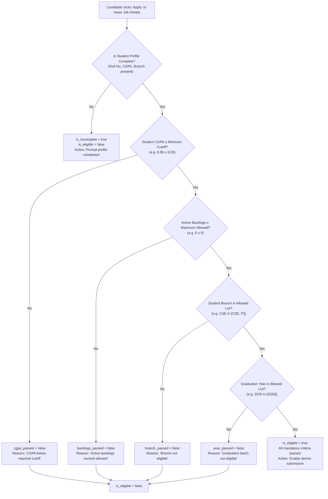

### Concrete Evaluation Signature & Example Payload
```sql
SELECT public.evaluate_job_eligibility(
  'e2b17f54-4a6c-4b53-9d8a-6b2a0c4f1e9d', -- Job ID
  '28296879-9cd1-43ef-bb8e-7939cb71d213'  -- Student ID (Aarav Sharma)
);
```

**Returned JSON (`jsonb`):**
```json
{
  "is_eligible": true,
  "is_incomplete": false,
  "reasons": [],
  "criteria": [
    { "id": "cgpa", "label": "Minimum CGPA Cutoff", "requiredValue": "≥ 8.00", "studentValue": "8.85", "passed": true, "missingData": false },
    { "id": "backlogs", "label": "Active Backlogs", "requiredValue": "≤ 0 backlogs", "studentValue": "0 active", "passed": true, "missingData": false },
    { "id": "branch", "label": "Eligible Degree & Branch", "requiredValue": "Computer Science & Engineering", "studentValue": "Computer Science & Engineering", "passed": true, "missingData": false },
    { "id": "batch", "label": "Graduation Batch", "requiredValue": "2026", "studentValue": "Class of 2026", "passed": true, "missingData": false },
    { "id": "skills", "label": "Core Competencies", "requiredValue": "React, TypeScript, Node.js", "studentValue": "React, TypeScript, Node.js, Python, PostgreSQL", "passed": true, "missingData": false }
  ]
}
```

---

## 11. Groq LPU™ Resume Intelligence Pipeline

The Resume Intelligence engine performs sub-second evidence-based resume comprehension on Groq's high-speed LPU™ inference cloud:

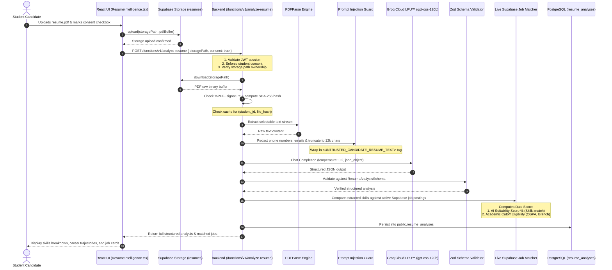

### AI Safety & Privacy Guardrails
1. **Mandatory Student Consent:** Invocations require `consent: true`. Analysis is blocked without explicit student authorization.
2. **PII Redaction:** Phone numbers and email addresses are scrubbed prior to dispatching text to the Groq API.
3. **Adversarial Input Isolation:** Resume text is framed within strict XML boundaries as untrusted data, preventing prompt injection instructions from modifying the model's behavior.
4. **Authoritative Boundary:** High AI suitability scores **never** override academic eligibility rules. A 95% skills match candidate who fails the minimum CGPA cutoff cannot apply.

> For full AI architecture, schemas, and prompting details, see [`docs/RESUME_INTELLIGENCE.md`](docs/RESUME_INTELLIGENCE.md).

---

## 12. Backend API, RPC & Edge Functions Reference

### Core PostgreSQL Stored Procedures

| Function Name | Caller Role | Purpose | Key Arguments | Return Type | Source File |
|---|---|---|---|---|---|
| `evaluate_job_eligibility` | `student`, `recruiter`, `placement_admin` | Evaluates student academic standing against job rules | `p_job_id (uuid)`, `p_student_id (uuid)` | `jsonb` | `20261030000003_functions_and_rpc.sql` |
| `submit_application` | `student` | Atomically validates eligibility, checks deadline, prevents duplicates, creates application record | `p_job_id (uuid)` | `jsonb` | `20261030000003_functions_and_rpc.sql` |
| `update_application_status` | `recruiter`, `placement_admin` | Enforces state machine transitions and logs audit history | `p_application_id (uuid)`, `p_new_status`, `p_reason` | `jsonb` | `20261030000003_functions_and_rpc.sql` |
| `withdraw_application` | `student`, `placement_admin` | Allows candidate to withdraw application from early stages | `p_application_id (uuid)` | `jsonb` | `20261030000003_functions_and_rpc.sql` |
| `schedule_interview` | `recruiter`, `placement_admin` | Schedules evaluation round in UTC and advances application | `p_application_id (uuid)`, `p_scheduled_at`, `p_mode`, `p_meeting_url`, `p_round` | `jsonb` | `20261030000003_functions_and_rpc.sql` |
| `get_placement_analytics` | `student`, `recruiter`, `placement_admin` | Calculates campus placement metrics with zero double-counting | *(None)* | `jsonb` | `20261030000003_functions_and_rpc.sql` |

### Intelligence Microservice & Edge Functions

| Endpoint | Method | Caller Role | Purpose | Source File |
|---|---|---|---|---|
| `/functions/v1/analyze-resume` | `POST` | `student` | Extracts PDF text, invokes Groq LPU™ AI, validates with Zod, and matches against active jobs. | `server/src/index.mjs` & `supabase/functions/analyze-resume` |
| `/functions/v1/manage-recruiter` | `POST` | `placement_admin` | Provisions corporate recruiter credentials, associates company memberships, lists, and revokes access. | `server/src/index.mjs` & `supabase/functions/manage-recruiter` |
| `/functions/v1/health` | `GET` | `public` | Microservice reachability check and configured Groq model reporting. | `server/src/index.mjs` |

> For parameter specifications and example JSON payloads, see [`docs/API_REFERENCE.md`](docs/API_REFERENCE.md).

---

## 13. Role-Specific Purposeful Analytics

Instead of filling dashboards with decorative, uninformative pie charts, CampusFlow implements **purposeful data visualizations** using Recharts:

```
[ Recharts Visualizations Portfolio ]
├── ChartFunnel.tsx          --> Candidate Throughput Funnel (Applied -> Shortlisted -> Interview -> Selected)
├── ChartBarHorizontal.tsx   --> Department-wise Placement Conversion Rates & CTC Package Rankings
├── ChartPieDonut.tsx        --> Pipeline Stage Breakdown with Centered Percentage KPI
└── InterviewTimeline.tsx    --> Chronological Round Tracker with Direct .ics Calendar Export
```

### Visualizations Rationale

| User Role | Visualization Component | Metric Displayed | Design Justification |
|---|---|---|---|
| **Student** | `CareerCompass.tsx` | Context-aware action radar | Replaces static counters with an intelligent priority radar highlighting upcoming interviews, profile gaps, and closing drives. |
| **Recruiter** | `ChartFunnel.tsx` | Candidate Throughput Funnel | Shows stage-by-stage attrition (Applied → Shortlisted → Interview → Offers) so recruiters immediately spot pipeline bottlenecks. |
| **Recruiter** | `ChartPieDonut.tsx` | Pipeline Stage Allocation | Clean donut chart with restrained palette and centered count, avoiding unreadable multi-slice pie charts. |
| **Admin** | `ChartBarHorizontal.tsx` | Department Placement Rate | Horizontal bars with monospace values allow clean side-by-side comparison of engineering branches with long names. |
| **Admin** | Placement Rate Donut | Institutional Placement % | Center KPI displays `52.4%` placed rate, mathematically guarded against double-counting students with multiple offers. |

---

## 14. Security Architecture & Threat Model

CampusFlow enforces enterprise-grade security at every layer:

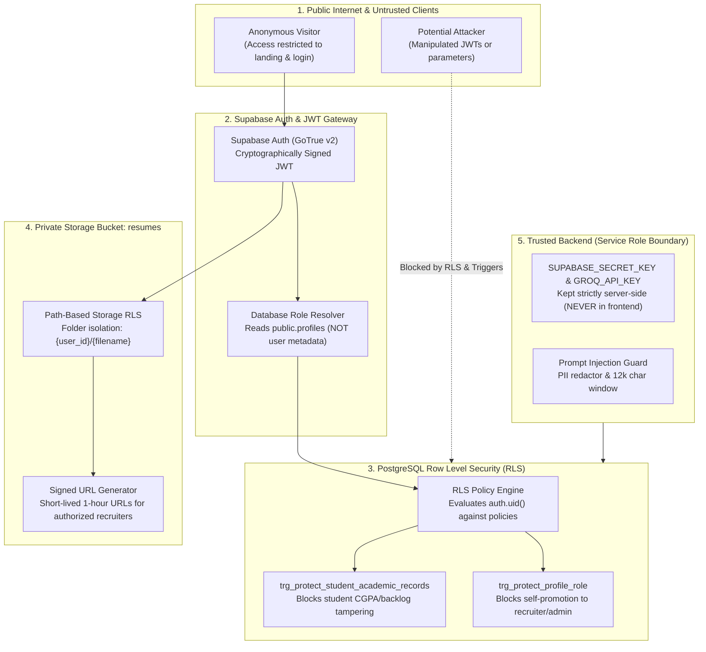

### Security Defenses
- **Recruiter Company Isolation:** Recruiters can only access student profiles and resumes of candidates who have actively applied to their company's job postings (`is_recruiter_for_student_resume`).
- **Academic Record Protection:** Student records (CGPA, roll number, department, backlogs) cannot be modified by students via PostgREST; only administrators have write authority.
- **Service Role Secret Protection:** `SUPABASE_SECRET_KEY` and `GROQ_API_KEY` reside exclusively in the root `.env` and are never embedded into client-side bundles.

---

## 15. Verification, Testing & Quality Gates

The CampusFlow codebase is backed by multiple automated test suites:

```
[ Automated Test Suites Summary ]
├── Real PostgreSQL Engine In-Memory Harness (PGlite 16.4)  --> PASSED (14 tables, 11 enums, 18 RPCs, 8 triggers)
├── Supabase Integration & Security Suite (68 Assertions)    --> PASSED (68 passed, 0 failed)
├── End-to-End Recruitment Journey Simulation (11 Steps)     --> PASSED (0 errors, 3 failure cases verified)
└── Client Production Build (tsc -b && vite build)           --> PASSED (0 TypeScript errors)
```

### 1. Real PostgreSQL Engine In-Memory Harness
Executes the master SQL migration against a real embedded PostgreSQL 16.4 engine (`@electric-sql/pglite`):
```bash
node scripts/test_real_postgresql_execution.js
```
*Output: 14 tables, 11 custom enums, 18 stored functions, 8 triggers, 100% RLS enabled, and idempotency verified.*

### 2. Supabase Integration & Security Suite
Validates AST syntax, table coverage, RLS declarations, state machine transitions, and analytics consistency:
```bash
node tests/supabase_integration_test.js
```
*Output: 68 assertions passed, 0 failed.*

### 3. End-to-End Recruitment Lifecycle Simulation
Simulates the full recruitment journey from Admin drive empanelment to Recruiter posting, candidate application, ATS review, interview scheduling, offer selection, and analytics update:
```bash
node tests/e2e_recruitment_lifecycle.js
```
*Output: 11 steps completed cleanly, verifying 3 failure cases (ineligible candidate, expired deadline, duplicate application).*

### 4. Client TypeScript Compilation & Production Build
```bash
npm run build --prefix client
```
*Output: TypeScript compilation passed cleanly (`tsc -b`), Vite production bundle generated in `client/dist/` with 0 errors.*

---

## 16. Local Development Quickstart

### Prerequisites
- **Node.js:** v18.0.0 or higher (v20+ or v22+ recommended)
- **npm:** v9.0.0 or higher
- **Git:** v2.30+

### Step 1: Clone Repository & Install Dependencies
```bash
git clone https://github.com/Rohit-Andhavarapu/CampusFlow.git
cd CampusFlow

# Install root dependencies
npm install

# Install client dependencies
cd client
npm install
cd ..
```

### Step 2: Configure Environment Variables
Create a `.env` file in the project root:
```env
# Supabase Project Connection
SUPABASE_URL=https://<your-project-id>.supabase.co
VITE_SUPABASE_URL=https://<your-project-id>.supabase.co
VITE_SUPABASE_PUBLISHABLE_KEY=your_supabase_anon_publishable_key
SUPABASE_SECRET_KEY=your_supabase_service_role_secret_key

# Groq LPU™ Cloud AI
GROQ_API_KEY=your_groq_api_key
GROQ_MODEL=openai/gpt-oss-120b

# Microservice Port & Offline Fallback
PORT=3001
VITE_ENABLE_DEMO_FALLBACK=true
```

And create `client/.env`:
```env
VITE_SUPABASE_URL=https://<your-project-id>.supabase.co
VITE_SUPABASE_PUBLISHABLE_KEY=your_supabase_anon_publishable_key
```

### Step 3: Run Development Servers
Open two terminal windows:

**Terminal 1 — Backend Intelligence Microservice:**
```bash
node server/src/index.mjs
# Running at http://localhost:3001
```

**Terminal 2 — Frontend Application:**
```bash
npm run dev --prefix client
# Running at http://localhost:5173
```

Open `http://localhost:5173` in your browser.

> For detailed local development instructions, see [`docs/DEVELOPMENT.md`](docs/DEVELOPMENT.md).

---

## 17. Supabase Cloud Deployment Runbook

Deploying CampusFlow to Supabase Cloud takes less than 10 minutes:

1. **Create Supabase Project:** Create a new project in the [Supabase Dashboard](https://supabase.com/dashboard).
2. **Execute Master SQL:** Open the **SQL Editor** in Supabase, paste the contents of `supabase/CAMPUSFLOW_MASTER_DEPLOYMENT_FIXED.sql`, and click **Run**.
3. **Execute Supplementary Migrations:** Run `supabase/migrations/20261031_student_watchlist.sql` and `supabase/migrations/20261031000001_resume_intelligence.sql`.
4. **Provision Demo Users:** Run `node scripts/provision_demo_users.js` to create the three evaluation accounts.
5. **Configure Storage:** Create a private bucket named `resumes` (5 MB limit, PDF MIME only).
6. **Deploy Edge Functions (Optional):**
   ```bash
   supabase functions deploy analyze-resume
   supabase functions deploy manage-recruiter
   ```

> For the comprehensive production deployment guide, see [`docs/DEPLOYMENT.md`](docs/DEPLOYMENT.md).

---

## 18. Google OAuth Setup

CampusFlow supports Google Single Sign-On:

1. In [Google Cloud Console](https://console.cloud.google.com/), create an **OAuth 2.0 Web Client ID**.
2. Set Authorized JavaScript Origins to `http://localhost:5173` and your production domain.
3. Set Authorized Redirect URI to `https://<your-project-ref>.supabase.co/auth/v1/callback`.
4. In Supabase Dashboard, navigate to **Authentication** → **Providers** → **Google**, enable the provider, and enter your Google Client ID and Secret.
5. In Supabase **URL Configuration**, add `http://localhost:5173/auth/callback` to the redirect allowlist.

---

## 19. Project Structure

```
CampusFlow/
├── client/                                    # Frontend React 18 Application
│   ├── src/
│   │   ├── components/                        # UI and Layout Components
│   │   │   ├── charts/                        # Custom Recharts Visualizations
│   │   │   │   ├── ChartBarHorizontal.tsx     # Horizontal CTC & Department distribution
│   │   │   │   ├── ChartFunnel.tsx            # Candidate conversion throughput funnel
│   │   │   │   ├── ChartPieDonut.tsx          # Status pipeline donut chart
│   │   │   │   └── InterviewTimeline.tsx      # Chronological interview tracker
│   │   │   ├── layout/                        # Workstation Shell (Sidebar, Header, AppShell)
│   │   │   ├── recruiter/                     # CandidateCompare.tsx matrix modal
│   │   │   ├── student/                       # CareerCompass.tsx priority action radar
│   │   │   └── ui/                            # Atomic design primitives (Card, Badge, Button, Dialog)
│   │   ├── context/AppContext.tsx             # Centralized state provider & auth bridge
│   │   ├── pages/                             # Route Page Controllers
│   │   │   ├── admin/                         # Command Center, Drives, Analytics, Recruiter Access
│   │   │   ├── auth/                          # Login, Signup, OAuth, Demo personas
│   │   │   ├── landing/                       # Public Editorial Prestige Landing Page
│   │   │   ├── recruiter/                     # Recruiter Dashboard, ATS Applicants, Jobs
│   │   │   └── student/                       # Resume AI, What-If Lab, Watchlist, Applications
│   │   ├── services/
│   │   │   ├── campusflowService.ts           # Typed RPC calls, adapters & services
│   │   │   └── supabase.ts                    # Supabase client initialization
│   │   └── types/                             # TypeScript interfaces & database models
│   └── vite.config.ts                         # Dev server & reverse proxy configuration
│
├── server/                                    # Backend Intelligence Microservice
│   └── src/index.mjs                          # PDF text parser, Groq AI & recruiter management
│
├── supabase/                                  # Database & Cloud Assets
│   ├── functions/                             # Deno Edge Functions (analyze-resume, manage-recruiter)
│   ├── migrations/                            # Version-controlled SQL migrations (001 to 005)
│   ├── CAMPUSFLOW_MASTER_DEPLOYMENT_FIXED.sql # Master idempotent deployment script (1,722 lines)
│   └── DEPLOYMENT_GUIDE.md                    # Database runbook
│
├── docs/                                      # Deep-Dive Technical Documentation
│   ├── assets/screenshots/                    # Verified application screenshots
│   ├── ARCHITECTURE.md                        # High-level system architecture
│   ├── DATABASE_SCHEMA.md                     # Schema, constraints & RLS reference
│   ├── API_REFERENCE.md                       # RPC & Edge Function documentation
│   ├── AUTHENTICATION.md                      # Auth flows, OAuth & anti-escalation
│   ├── RESUME_INTELLIGENCE.md                 # Groq LPU™ AI pipeline & security
│   ├── DEPLOYMENT.md                          # Supabase Cloud deployment runbook
│   └── DEVELOPMENT.md                         # Local dev setup and test guide
│
├── scripts/                                   # Verification, Provisioning & QA Scripts
│   ├── provision_demo_users.js                # GoTrue Admin API account creator
│   ├── test_real_postgresql_execution.js      # PGlite real PostgreSQL engine harness
│   └── capture_responsive_viewports.mjs       # Headless screenshot automation
│
└── tests/                                     # Automated Test Suites
    ├── supabase_integration_test.js           # 68 SQL, RLS & RPC integrity assertions
    └── e2e_recruitment_lifecycle.js           # 11-step recruitment journey simulation
```

---

## 20. Development Roadmap

```
[ CampusFlow Strategic Roadmap ]
├── V1.0 - UI Foundation & Workstation Shell (Complete)
├── V2.0 - Student & Recruiter Experience Portals (Complete)
├── V3.0 - Editorial Prestige Visual Polish & Responsive QA (Complete)
├── V4.0 - Supabase Full-Stack Integration (PostgreSQL, 14 Tables, RLS, RPCs) (Complete)
├── V4.5 - Analytics Upgrade (Candidate Compare, What-If Lab, Watchlist, Placement Pulse) (Complete)
├── V5.0 - Groq LPU™ Resume Intelligence & Recruiter Access Provisioning (Complete)
└── Future Capabilities (Planned Scope):
    ├── Multi-University Tenant Partitioning
    ├── Automated Two-Way Google Calendar / Microsoft Outlook OAuth Sync
    ├── WhatsApp & SMS Notification Webhooks
    └── AI-Assisted Resume LaTeX Formatter & Interactive Resume Builder
```

---

## 21. Contributing & License

### Contribution Workflow
1. Fork the repository.
2. Create a feature branch: `git checkout -b feature/recruitment-enhancement`.
3. Verify that all test suites pass:
   ```bash
   node scripts/test_real_postgresql_execution.js
   node tests/supabase_integration_test.js
   node tests/e2e_recruitment_lifecycle.js
   npm run build --prefix client
   ```
4. Commit your changes with descriptive commit messages.
5. Push to the branch and submit a Pull Request.

### License
CampusFlow is open-source software licensed under the **MIT License**.  
See the [`LICENSE`](LICENSE) file for complete details.  
Copyright &copy; 2026 Rohit Andhavarapu.

---

<p align="center">
  <strong>CampusFlow &bull; Your Future. In Motion.</strong><br>
  Engineered for university students, recruiters, and placement directors worldwide.
</p>
