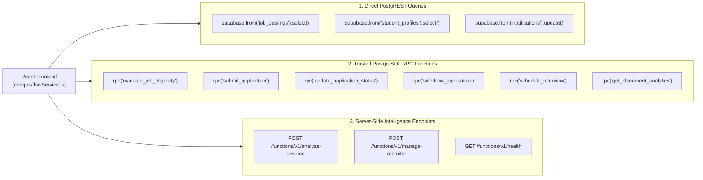

# CampusFlow — Backend API, RPC & Microservice Reference

> **Architecture:** PostgreSQL RPCs + Supabase PostgREST + Edge Functions / Node.js Microservice  
> **Security:** JWT Authentication (`Bearer <token>`), Non-negotiable RLS, and Role-Gated Execution  
> **Source Files:** `supabase/migrations/20261030000003_functions_and_rpc.sql`, `server/src/index.mjs`, `client/src/services/campusflowService.ts`

---

## 1. Overview of Backend Invocations

CampusFlow strictly categorizes backend communications into three operational patterns:



---

## 2. PostgreSQL RPC Reference

### 1. `evaluate_job_eligibility`
- **Caller Role:** `student`, `recruiter`, `placement_admin`
- **Purpose:** Authoritative evaluation of a candidate's eligibility against published job rules.
- **Security:** `SECURITY DEFINER`. Verifies that the caller is the student themselves, the recruiter for the job's company, or an administrator.
- **Arguments:**
  | Argument | Type | Description |
  |---|---|---|
  | `p_job_id` | `uuid` | Target job posting ID |
  | `p_student_id` | `uuid` | Target student profile ID |

- **Response Signature (`jsonb`):**
  ```json
  {
    "is_eligible": true,
    "is_incomplete": false,
    "reasons": [],
    "criteria": [
      {
        "id": "cgpa",
        "label": "Minimum CGPA Cutoff",
        "requiredValue": "≥ 8.00",
        "studentValue": "8.85",
        "passed": true,
        "missingData": false
      },
      {
        "id": "backlogs",
        "label": "Active Backlogs",
        "requiredValue": "≤ 0 backlogs",
        "studentValue": "0 active",
        "passed": true,
        "missingData": false
      },
      {
        "id": "branch",
        "label": "Eligible Degree & Branch",
        "requiredValue": "Computer Science & Engineering, Information Technology",
        "studentValue": "Computer Science & Engineering",
        "passed": true,
        "missingData": false
      },
      {
        "id": "batch",
        "label": "Graduation Batch",
        "requiredValue": "2026",
        "studentValue": "Class of 2026",
        "passed": true,
        "missingData": false
      },
      {
        "id": "skills",
        "label": "Core Competencies",
        "requiredValue": "React, TypeScript, Node.js",
        "studentValue": "React, TypeScript, Node.js, Python, PostgreSQL",
        "passed": true,
        "missingData": false
      }
    ]
  }
  ```

---

### 2. `submit_application`
- **Caller Role:** `student` (Authenticated session required)
- **Purpose:** Atomically verifies eligibility, checks application deadline, prevents duplicates, records the application, creates initial status history, and dispatches in-app notification in a single database transaction.
- **Security:** `SECURITY DEFINER`. Blocks non-student callers.
- **Arguments:**
  | Argument | Type | Description |
  |---|---|---|
  | `p_job_id` | `uuid` | Target job posting ID |

- **Success Response (`jsonb`):**
  ```json
  {
    "success": true,
    "application_id": "c7a840e6-b924-4f05-87d1-08f51a44ef6e",
    "message": "Successfully applied to Senior Frontend Engineer at NovaTech Systems."
  }
  ```
- **Error Scenarios:**
  - `Unauthorized`: User not logged in.
  - `Forbidden`: Non-student account attempting submission.
  - `Profile Incomplete`: Student profile missing CGPA, branch, or roll number.
  - `Job Expired`: Application deadline passed.
  - `Eligibility Failed`: Returns specific criteria gap reason.
  - `Duplicate Application`: Student already has an active application for this job.

---

### 3. `update_application_status`
- **Caller Role:** `recruiter`, `placement_admin`
- **Purpose:** Evaluates applicant stage progression against the strict recruitment state machine.
- **Security:** `SECURITY DEFINER`. Enforces that the recruiter belongs to the job's company.
- **Arguments:**
  | Argument | Type | Description |
  |---|---|---|
  | `p_application_id` | `uuid` | Application record ID |
  | `p_new_status` | `application_status_type` | `'shortlisted' \| 'interview' \| 'selected' \| 'rejected'` |
  | `p_reason` | `text` *(optional)* | Auditor explanation for stage update |

- **Allowed State Transitions:**
  | Current Stage | Permitted Next Stages | Forbidden Transitions |
  |---|---|---|
  | `submitted` | `shortlisted`, `rejected` | `interview`, `selected`, `withdrawn` |
  | `shortlisted` | `interview`, `rejected` | `submitted`, `selected` |
  | `interview` | `selected`, `rejected` | `submitted`, `shortlisted` |
  | `selected` | *(None — Terminal)* | Any change prohibited |
  | `rejected` | *(None — Terminal)* | Any change prohibited |
  | `withdrawn` | *(None — Terminal)* | Any change prohibited |

- **Success Response (`jsonb`):**
  ```json
  {
    "success": true,
    "previous_status": "submitted",
    "new_status": "shortlisted",
    "message": "Candidate status successfully updated to shortlisted."
  }
  ```

---

### 4. `withdraw_application`
- **Caller Role:** `student` (Applicant owner) or `placement_admin`
- **Purpose:** Allows a student to voluntarily withdraw an application from `submitted` or `shortlisted` stages.
- **Arguments:**
  | Argument | Type | Description |
  |---|---|---|
  | `p_application_id` | `uuid` | Application record ID |

- **Restrictions:** Withdrawal is prohibited once the candidate advances to the `interview` or `selected` stage (requires contacting placement cell).

---

### 5. `schedule_interview`
- **Caller Role:** `recruiter`, `placement_admin`
- **Purpose:** Schedules an evaluation round, records UTC meeting coordinates, automatically advances application status to `interview`, and notifies the student.
- **Arguments:**
  | Argument | Type | Description |
  |---|---|---|
  | `p_application_id` | `uuid` | Target application ID |
  | `p_scheduled_at` | `timestamptz` | Interview date and time (must be in future) |
  | `p_duration_minutes` | `integer` | Default 45 minutes |
  | `p_mode` | `interview_mode_type` | `'Virtual' \| 'In-Person'` |
  | `p_location` | `text` *(optional)* | Physical room / building |
  | `p_meeting_url` | `text` *(optional)* | Video conferencing link (Google Meet / Zoom) |
  | `p_round` | `text` | e.g. "Round 1 — Technical Architecture" |
  | `p_notes` | `text` *(optional)* | Preparation instructions for candidate |

- **Success Response (`jsonb`):**
  ```json
  {
    "success": true,
    "interview_id": "893c52b7-a3f2-45e6-990a-5c1284de9912",
    "message": "Successfully scheduled Round 1 — Technical Architecture for candidate."
  }
  ```

---

### 6. `get_placement_analytics`
- **Caller Role:** `student`, `recruiter`, `placement_admin`
- **Purpose:** Calculates campus-wide placement metrics with **zero double-counting** guarantee.
- **Formula:** $\text{Total Students} = \text{Placed} + \text{In Process} + \text{Unplaced}$
- **Response Signature (`jsonb`):**
  ```json
  {
    "total_students": 20,
    "placed_students": 11,
    "in_process_students": 5,
    "unplaced_students": 4,
    "placement_rate": 55.0,
    "active_drives": 3,
    "partner_companies": 6,
    "department_stats": [
      { "name": "Computer Science & Engineering", "total": 12, "placed": 8, "rate": 66.7 },
      { "name": "Electronics & Communication", "total": 5, "placed": 2, "rate": 40.0 },
      { "name": "Mechanical Engineering", "total": 3, "placed": 1, "rate": 33.3 }
    ]
  }
  ```

---

## 3. Server-Side Intelligence & Microservice Endpoints

### 1. `POST /functions/v1/analyze-resume`
- **Runtime:** Node.js HTTP Microservice (`server/src/index.mjs`) & Supabase Edge Function (`supabase/functions/analyze-resume/index.ts`).
- **Authorization:** `Bearer <Supabase_JWT>` (Authenticated student session).
- **Request Headers:**
  - `Content-Type: application/json`
  - `Authorization: Bearer <user_jwt_token>`
- **Request Body (`json`):**
  ```json
  {
    "resumeFileId": "optional-uuid",
    "storagePath": "optional-resumes/user-id/resume.pdf",
    "pdfBase64": "JVBERi0xLjQKMSAwIG...",
    "consent": true,
    "forceReanalyze": false
  }
  ```
- **Processing Pipeline:**
  1. Validates `consent === true` (Mandatory student privacy consent).
  2. Enforces storage path ownership (`storagePath` must contain caller's `user.id`).
  3. Verifies `%PDF-` file signature and extracts selectable text with `pdf-parse`.
  4. Redacts PII (phone numbers, email addresses) and truncates to 12,000 characters to safeguard against prompt injection.
  5. Computes SHA-256 hash for local & database cache check.
  6. Dispatches to Groq LPU™ Cloud (`openai/gpt-oss-120b`, `response_format: { type: "json_object" }`).
  7. Validates returned structure against strict `zod` schema.
  8. Evaluates candidate skills against all active Supabase `job_postings` (Dual-Score matching).
  9. Persists analysis to `public.resume_analyses`.

- **Success Response (HTTP 200):**
  ```json
  {
    "success": true,
    "source": "groq",
    "analysisId": "8f82f80d-838d-4ad1-9efb-950c45ef4261",
    "studentId": "28296879-9cd1-43ef-bb8e-7939cb71d213",
    "model": "openai/gpt-oss-120b",
    "filename": "Aarav_Sharma_Resume.pdf",
    "fileHash": "7f8b91a24d08...",
    "pageCount": 1,
    "summary": "High-performing full-stack candidate with proven experience in TypeScript, React, and PostgreSQL.",
    "extractedSkills": [
      { "name": "TypeScript", "category": "Programming Languages", "is_explicit": true },
      { "name": "React", "category": "Frontend", "is_explicit": true },
      { "name": "PostgreSQL", "category": "Databases", "is_explicit": true }
    ],
    "careerMatches": [
      {
        "role_title": "Full-Stack Engineer",
        "fit_percentage": 92,
        "reasoning": "Strong evidence across React, Node.js, and relational database design.",
        "missing_competencies": ["GraphQL"],
        "recommended_action": "Complete a production GraphQL API microservice."
      }
    ],
    "matchedJobs": [
      {
        "job_id": "job_1",
        "title": "Senior Frontend Engineer",
        "company_name": "NovaTech Systems",
        "suitability_score": 88,
        "matching_skills": ["React", "TypeScript", "Tailwind CSS"],
        "missing_skills": ["Next.js"],
        "academic_eligibility": {
          "eligible": true,
          "cgpa_met": true,
          "branch_met": true,
          "backlogs_met": true,
          "cgpa_cutoff": 7.5,
          "student_cgpa": 8.85,
          "reason": "Meets all published department CGPA and backlog thresholds."
        }
      }
    ]
  }
  ```

---

### 2. `POST /functions/v1/manage-recruiter`
- **Runtime:** Node.js HTTP Microservice (`server/src/index.mjs`) & Supabase Edge Function (`supabase/functions/manage-recruiter/index.ts`).
- **Authorization:** `Bearer <Supabase_JWT>` (Strictly gated to `role = 'placement_admin'`).
- **Actions Supported:**
  - `action = "list"`: Retrieves all active recruiters and pending invites with company linkages.
  - `action = "invite"`: Provisions a new recruiter account, creates profile, and links company membership.
  - `action = "resend"`: Triggers a re-send of invitation details.
  - `action = "revoke"`: Dissolves company membership and invalidates recruiter permissions.

---

### 3. `GET /functions/v1/health`
- **Purpose:** Microservice reachability check.
- **Response:**
  ```json
  {
    "status": "healthy",
    "model": "openai/gpt-oss-120b",
    "timestamp": "2026-10-31T15:45:00.000Z"
  }
  ```
