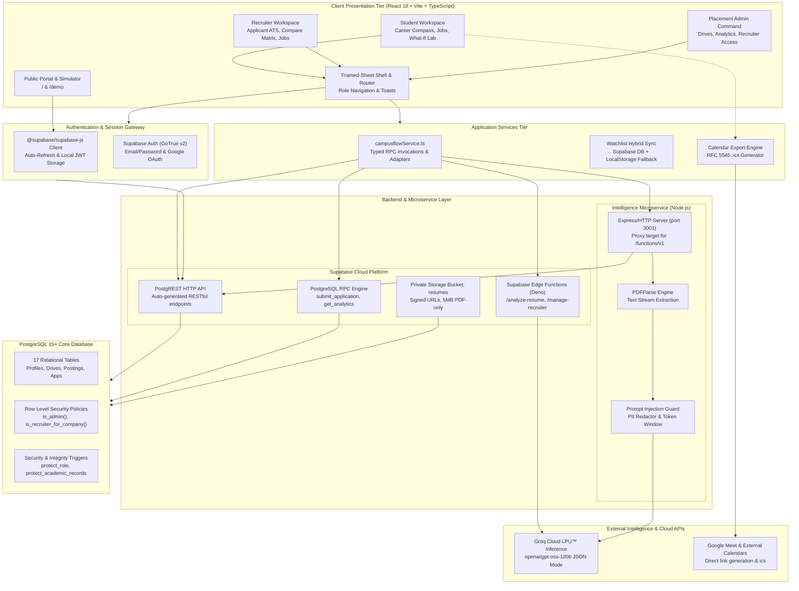
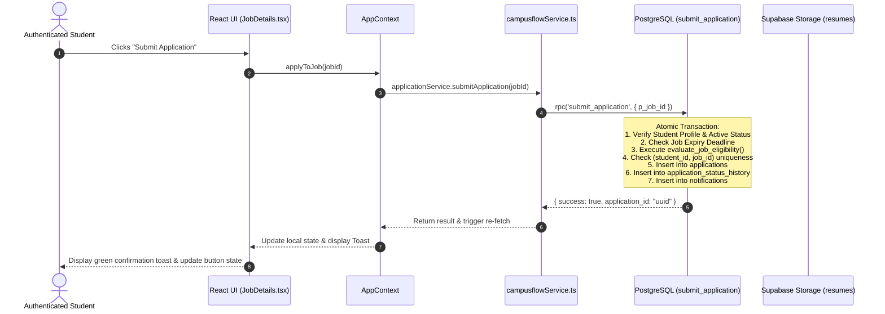

# CampusFlow — System Architecture & Technical Specifications

> **Problem Statement:** HACK-P410 — Campus Recruitment Management Portal  
> **Platform Version:** CampusFlow V4.5 / V5  
> **Architecture Pattern:** Multi-Role Workspace + Serverless Backend + LPU™ AI Acceleration

---

## 1. Architectural Philosophy

CampusFlow is engineered as a high-density, mission-critical enterprise workstation rather than a conventional student portal. Traditional university placement systems suffer from fragmented communications (WhatsApp, spreadsheets, disconnected notice boards), non-transparent academic filtering, and fragile resume parsing.

CampusFlow solves these foundational bottlenecks through three architectural pillars:

1. **Deterministic Eligibility Enforcement (PostgreSQL Engine):** Academic criteria (CGPA thresholds, allowed degree branches, standing backlogs, and graduation years) are evaluated authoritatively inside PostgreSQL stored procedures (`evaluate_job_eligibility`). Client-side code cannot bypass or fake qualification.
2. **Deterministic State Machine (Zero Duplicate / Out-of-Order Applications):** Candidate status transitions (`submitted` → `shortlisted` → `interview` → `selected` / `rejected`) are guarded by database transactions (`update_application_status`), protecting terminal states from unauthorized tampering.
3. **Decoupled AI Intelligence Boundary (Groq LPU™ Cloud):** Resume parsing and career recommendations are executed on the server-side via Groq's high-speed inference cloud (`openai/gpt-oss-120b`). The candidate resume text is treated as **untrusted data**, sanitized against prompt injection, parsed via `pdf-parse`, and validated with strict `zod` schemas before presentation.

---

## 2. End-to-End System Architecture

---

## 3. Workstation Presentation Architecture

The user interface follows the **Framed-Sheet Architecture** inspired by high-density workflow tools (Linear, Ashby, Basecamp):

| Layout Element | Implementation Details | Purpose |
|---|---|---|
| **Fixed Navigation Sidebar** | 240px width, `#F8FAFC` background, hairline right border `#E2E8F0` | Uncluttered, predictable navigation grouped by operational workflows. |
| **Top Action Header** | 56px height, persistent breadcrumbs, search shortcut, and live demo role switcher | Context awareness across Student, Recruiter, and Admin spaces. |
| **Worksheet Card Surfaces** | Crisp 0px to 4px borders, `#FFFFFF` surface with hairline dividers, 0 drop shadows at rest | Prevents visual fatigue during prolonged applicant evaluation. |
| **Visual Badge Hierarchy** | Semantic color-coded badges for status (`#0F766E` Teal for Selected, `#0284C7` Sky for Shortlisted, `#E11D48` Rose for Ineligible) | Instant visual triage across high-volume applicant queues. |
| **Accessible Visualizations** | Recharts components (`ChartFunnel`, `ChartPieDonut`, `ChartBarHorizontal`) | Transparent data representations with raw data table toggles. |

---

## 4. State Management & Data Flow

CampusFlow uses a centralized `AppContext` provider coupled with a typed service layer (`campusflowService.ts`):

---

## 5. Offline Fallback & Evaluation Architecture

To ensure zero downtime during evaluation, live demos, or local development without cloud connectivity, CampusFlow incorporates a **Dual-Mode Data Bridge**:

1. **Cloud-Connected Mode:**
   - Active when `VITE_SUPABASE_URL` and `VITE_SUPABASE_PUBLISHABLE_KEY` are configured.
   - All operations execute against live Supabase PostgreSQL tables, RPCs, and Auth.
2. **Isolated Demonstration Sandbox Mode:**
   - Active when credentials are unconfigured or when accessing `/demo`.
   - Seeded in-memory data structures (`initialApplications`, `mockJobPostings`, `initialStudentProfile`) provide immediate interactivity.
   - Demonstrates all three personas:
     - **Student:** Aarav Sharma (`aarav.sharma@campus.edu`)
     - **Recruiter:** Priya Nair (`priya.nair@novatech.io`)
     - **Administrator:** Dr. Rajesh Rao (`placements@campus.edu`)
   - Guaranteed zero runtime exceptions, zero infinite spinners, and 100% feature representation.
