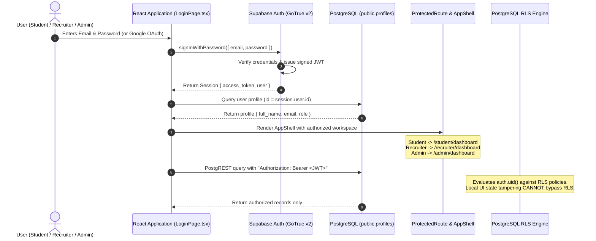

# CampusFlow — Authentication, Authorization & Security Architecture

> **Authentication Provider:** Supabase Auth (GoTrue v2.197+)  
> **Identity Standards:** OIDC / OAuth 2.0 (Google), Email/Password, JWT Bearer Tokens  
> **Authorization Engine:** PostgreSQL Row Level Security (RLS) + SECURITY DEFINER Triggers

---

## 1. Authentication Architecture Overview

CampusFlow enforces a strict separation between **Authentication** (verifying who a user is) and **Authorization** (verifying what data a user can access).



---

## 2. The Three User Roles

CampusFlow defines three distinct domain roles governed by the `user_role_type` database enum:

| Role | Permitted Registration Path | Permissions & Data Isolation | Default Landing Route |
|---|---|---|---|
| **`student`** | Public Signup (`/signup`) or Google OAuth | Can read active job postings, manage own student profile, view own applications, submit applications via `submit_application()`, and access Groq Resume Intelligence. Blocked from recruiter and admin operations. | `/student/dashboard` |
| **`recruiter`** | Invited & Provisioned by Placement Administrator (`/admin/recruiters`) | Scoped exclusively to their assigned employer organization via `recruiter_company_memberships`. Can publish jobs, review applicants who applied to their company, schedule interviews, and record hiring decisions. Cannot view competitors' applicant data. | `/recruiter/dashboard` |
| **`placement_admin`** | Secure Seed / Institutional Superuser | Full supervisory oversight across the university ecosystem: empanels companies, schedules recruitment drives, provisions recruiter accounts, views institutional analytics, and exports accreditation reports. | `/admin/dashboard` |

---

## 3. Anti-Privilege Escalation Triggers

### 1. Default Student Role Assignment
When a user registers publicly via email or Google OAuth, client metadata **is never trusted** to grant permissions. The database trigger `on_auth_user_created` strictly assigns `role = 'student'`:

```sql
create or replace function public.handle_new_user()
returns trigger as $$
declare
  v_full_name text;
begin
  v_full_name := coalesce(
    new.raw_user_meta_data->>'full_name',
    new.raw_user_meta_data->>'name',
    split_part(new.email, '@', 1)
  );

  insert into public.profiles (id, email, full_name, role)
  values (new.id, new.email, v_full_name, 'student'::user_role_type)
  on conflict (id) do update set
    email = excluded.email,
    full_name = excluded.full_name,
    updated_at = now();

  return new;
end;
$$ language plpgsql security definer set search_path = public;
```

### 2. Role Mutation Guard (`trg_protect_profile_role`)
If an attacker attempts to update their own `role` field in `public.profiles` via PostgREST, the `trg_protect_profile_role` trigger intercepts the operation and raises an exception:

```sql
create or replace function public.protect_profile_role()
returns trigger as $$
declare
  v_jwt_role text := coalesce(auth.role(), '');
begin
  if new.role is distinct from old.role then
    if v_jwt_role in ('authenticated', 'anon') and not public.is_admin() then
      raise exception 'Forbidden: Privilege escalation denied. Only placement administrators or trusted backend services can modify user roles.';
    end if;
  end if;
  return new;
end;
$$ language plpgsql security definer set search_path = public;
```

### 3. Academic Records Immutability Guard (`trg_protect_student_academic_records`)
Students are prohibited from altering their official CGPA, roll number, department branch, or active backlogs:

```sql
create or replace function public.protect_student_academic_records()
returns trigger as $$
declare
  v_jwt_role text := coalesce(auth.role(), '');
begin
  if (new.cgpa is distinct from old.cgpa) or
     (new.active_backlogs is distinct from old.active_backlogs) or
     (new.roll_number is distinct from old.roll_number) or
     (new.branch is distinct from old.branch) or
     (new.graduation_year is distinct from old.graduation_year) or
     (new.course is distinct from old.course) then
    if v_jwt_role in ('authenticated', 'anon') and not public.is_admin() then
      raise exception 'Forbidden: Verified academic records (CGPA, Roll Number, Branch, Graduation Year, Backlogs) cannot be modified by students. Contact the Training & Placement Cell.';
    end if;
  end if;
  return new;
end;
$$ language plpgsql security definer set search_path = public;
```

---

## 4. Google OAuth Setup & Configuration

CampusFlow natively supports Google Single Sign-On (SSO). Follow this configuration guide to connect your own Google Cloud project:

### Step 1: Google Cloud Console Configuration
1. Open the [Google Cloud Console](https://console.cloud.google.com/) and create a new project (e.g. `CampusFlow-Production`).
2. Navigate to **APIs & Services** → **OAuth consent screen**:
   - User Type: **External**
   - App Name: `CampusFlow Recruitment Portal`
   - User Support Email: Your administrator email
   - Authorized Domains: `supabase.co` and your production domain.
3. Navigate to **Credentials** → **Create Credentials** → **OAuth Client ID**:
   - Application Type: **Web Application**
   - Name: `CampusFlow Web Client`
   - Authorized JavaScript Origins:
     - `http://localhost:5173` (Local Development)
     - `https://your-production-domain.com`
   - Authorized Redirect URIs:
     - `https://<your-supabase-project-ref>.supabase.co/auth/v1/callback`

### Step 2: Supabase Authentication Configuration
1. In your [Supabase Dashboard](https://supabase.com/dashboard), navigate to **Authentication** → **Providers** → **Google**.
2. Toggle Google provider to **Enabled**.
3. Paste the **Client ID** and **Client Secret** obtained from Google Cloud.
4. Save the configuration.

### Step 3: URL Allowlist Configuration
In Supabase Dashboard under **Authentication** → **URL Configuration**:
- **Site URL:** `http://localhost:5173` (or production URL)
- **Redirect URLs:**
  - `http://localhost:5173/auth/callback`
  - `https://your-production-domain.com/auth/callback`

### Step 4: Frontend Callback Handling
The route `/auth/callback` renders `AuthCallbackPage.tsx`, which inspects the OAuth return code, exchanges it for a Supabase session, retrieves the user profile, and directs the user to their corresponding role dashboard.

---

## 5. Demonstration Personas vs. Real Accounts

To facilitate instant testing by judges, reviewers, and recruiters without manual registration, CampusFlow provides three pre-seeded evaluation personas accessible via [`/demo`](http://localhost:5173/demo):

| Persona | Email | Password | Pre-loaded Context |
|---|---|---|---|
| **Student** | `aarav.sharma@campus.edu` | `CampusFlow2026!` | B.Tech CSE (CGPA 8.85, 0 backlogs), 8 verified skills, 2 projects, 2 active applications, 1 scheduled interview. |
| **Recruiter** | `priya.nair@novatech.io` | `CampusFlow2026!` | Lead University Recruiter at NovaTech Systems, 2 published postings, 8 candidate applications in ATS pipeline. |
| **Placement Dean** | `placements@campus.edu` | `CampusFlow2026!` | Placement Director, full university metrics, 6 partner companies, 3 active drives, recruiter access management. |

> [!IMPORTANT]
> **Data Isolation Boundary:** Real registered users never inherit or view records belonging to these demo personas. Real users begin with an authentic empty state (0 applications, 0 interviews) and their actions are isolated strictly to their personal account.
