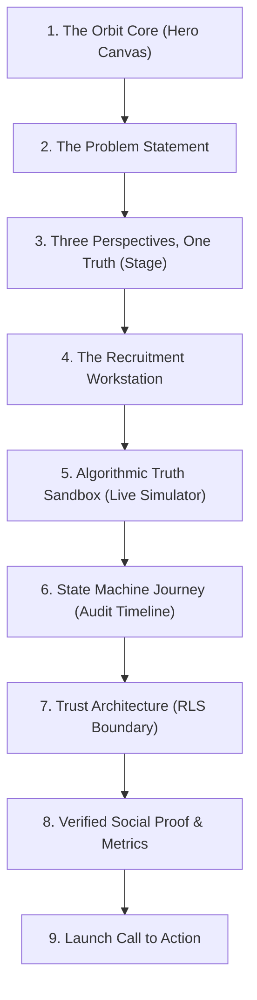

# CampusFlow V4 — Cinematic Landing Page Design Specification
## Apple-Grade Product Storytelling × Futuristic Sci-Fi Motion × Ashby Precision
### Hackathon Problem HACK-P410 | Google Antigravity & GSD

---

## 1. Design Philosophy & Vision

CampusFlow's landing page is engineered as a cinematic digital product experience rather than a generic SaaS marketing website. It is guided by four aesthetic and architectural pillars:

1. **Apple Product Launch Storytelling**: 
   A continuous, dramatic narrative arc where each section answers a singular emotional and technical question. Big typography, focused visual canvases, and seamless transitions replace fragmented feature grids.
2. **Sci-Fi Holographic HUD Aesthetics**:
   Deep void backgrounds (`#060B12`, `#0B111B`), luminous cyan/teal accents (`#72F4D1`, `#59D9FF`), subtle orbital particle tracks, and precision data telemetry evoke advanced operational command interfaces.
3. **Linear Visual Discipline & Ashby Density**:
   Zero generic cards, zero decorative emojis, zero fuzzy drop shadows, and zero unearned gradients. Every visual element reflects genuine system state, PostgreSQL RPC queries, and real application workflows.
4. **Emil Kowalski Motion Restraint**:
   Interactions never exceed 300ms. All interactive triggers feature spring-like active states (`scale(0.97)`), hardware-accelerated transforms (`transform`, `opacity`), and zero cumulative layout shift (CLS).

---

## 2. Master Color System & Craft Palette

| Token Name | Hex Code | Purpose |
| :--- | :--- | :--- |
| **Deep Space Void** | `#060B12` | Root page background, dark canvas backing |
| **Surface Workstation** | `#0B111B` | Surface cards, interactive stages, header backdrop |
| **Teal Deep Core** | `#0F766E` | Primary action fills, active tab indicators |
| **Luminous Mint** | `#72F4D1` | Primary telemetry accent, live eligibility highlights |
| **Cryo Cyan** | `#59D9FF` | Secondary recruiter accent, stage links |
| **Pure White** | `#F5F7FA` | Primary display headlines and titles |
| **Muted Slate** | `#94A3B8` / `#64748B` | Secondary body text, metadata timestamps |

---

## 3. The 9-Section Narrative Structure

### Section 1: The Orbit Core (`HeroCoreCanvas.tsx`)
- **Headline**: "Your Future. In Motion."
- **Interactive Component**: HTML5 Canvas rendering a 4-node orbital network (Verified Students, Opportunity Matrix, Talent Evaluation, Institutional T&P) with smooth cursor momentum interpolation, orbital particle streams, and live telemetry badges.
- **Header**: Persistent sticky bar (`LandingHeader.tsx`) with 1-click Quick Persona switcher for hackathon judges (`Aarav - Student`, `Priya - Recruiter`, `Dr. Rao - Admin`).

### Section 2: The Problem Statement
- **Headline**: "Scattered opportunities to one connected future."
- **Narrative**: Contrasts the broken, spreadsheet-driven campus placement status quo (black-box rejections, candidate hoarding, untracked PDF resumes) with CampusFlow's unified cryptographic ecosystem.

### Section 3: Three Perspectives, One Unified Truth (`RoleShowcaseStage.tsx`)
- **Headline**: "Three perspectives. One unified truth."
- **Interactive Component**: Fluid tab switcher toggling between three genuine product workstations:
  - **Student Experience**: Pre-application verification, real-time eligibility scores, live offer tracking.
  - **Recruiter Workstation**: Split-pane candidate queue, Ashby-style review, 1-click Google Meet interview dispatch.
  - **Placement Administration**: Real-time batch placement rates (55% placed), branch breakdowns, NAAC/NIRF accreditation CSV export.

### Section 4: The Recruitment Workstation UI Reveal
- **Headline**: "The Recruitment Workstation."
- **Visual Artifact**: High-density recruiter dossier browser frame simulating candidate review with verified CGPA badges, skill chips, and live interview scheduling triggers.

### Section 5: The Algorithmic Truth Sandbox ("One Live Thing", `EligibilitySandbox.tsx`)
- **Headline**: "Know where you stand. Before you apply."
- **Live Simulator**: Real-time interactive cutoff engine allowing prospective students or judges to adjust CGPA sliders (5.00 - 10.00), toggle branches (CSE, IT, AI&DS, ECE, ME), toggle backlog standing, and select technical skills. Instantly updates eligibility state using the mathematical logic of PostgreSQL RPC `evaluate_job_eligibility()`.

### Section 6: State Machine Career Journey (`ApplicationJourneyTimeline.tsx`)
- **Headline**: "Every milestone. Beautifully clear."
- **Interactive Timeline**: An Apple-style segmented scrub rail showing an application traversing immutable states: `Applied` $\to$ `Under Review` $\to$ `Shortlisted` $\to$ `Interview Scheduled` $\to$ `Offered`. Displays complete timestamped audit logs for each stage.

### Section 7: Cryptographic Trust & Role Boundary (`CampusEcosystemNetwork.tsx`)
- **Headline**: "Trust Across Every Role."
- **Architecture Diagram**: Visualizes Row Level Security (RLS) enforcement, database-level role isolation, and tamper-proof multi-tenant recruitment workflows.

### Section 8: Verified Social Proof & Institutional Metrics
- **Headline**: "Campus recruitment, measured with precision."
- **Telemetry Grid**: Displays real numbers from the live database: 6 enterprise partners, 55.0% batch placement rate, ₹14.0 LPA average package, and 100% verified student records.

### Section 9: Final Call to Action & Directory Footer (`LandingFooter.tsx`)
- **Headline**: "Experience the future of campus recruitment."
- **Action Triggers**: Instant launch buttons linking to Student, Recruiter, and Admin portals, alongside a full institutional directory footer compliant with sub-13px typography rules.
