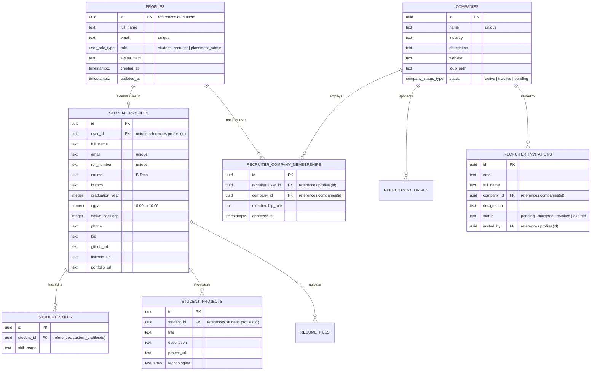
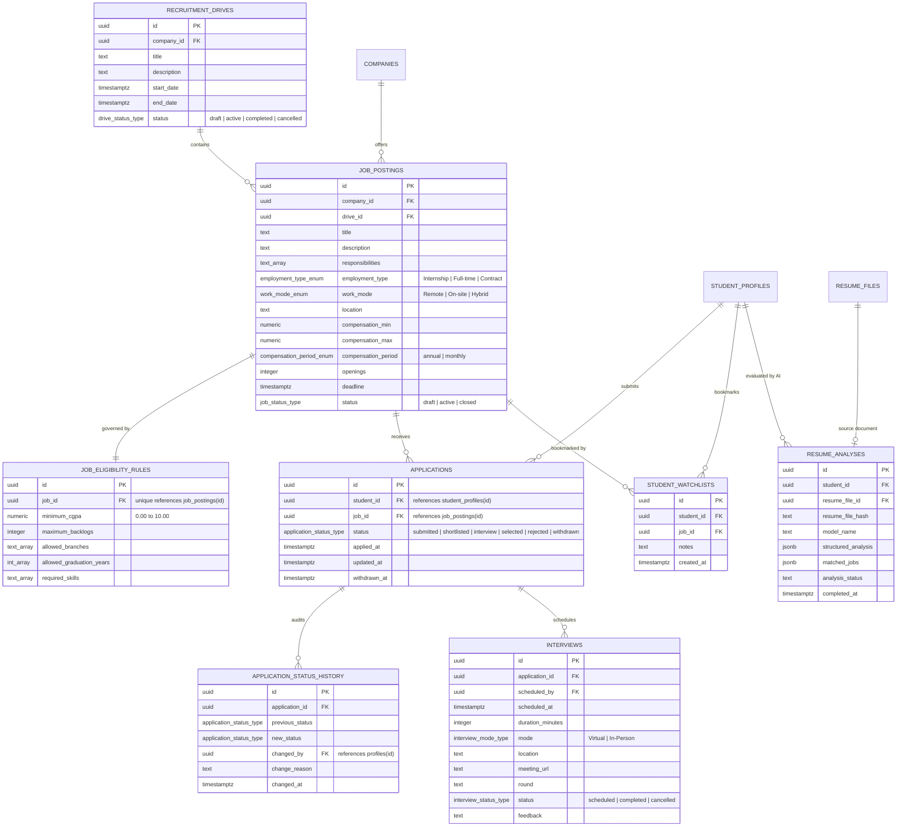

# CampusFlow — Complete Database Schema & RLS Reference

> **Database Engine:** PostgreSQL 15+ (Supabase Cloud & PGlite WASM 16.4 compatible)  
> **Table Count:** 17 Normalized Relational Tables  
> **Security Coverage:** 100% Tables Guarded by Row Level Security (RLS)  
> **Integrity Verification:** Tested via Real PostgreSQL Engine Harness (`scripts/test_real_postgresql_execution.js`)

---

## 1. Relational Entity Relationship Diagrams (ERDs)

To maintain clarity, the relational data model is presented in two focused ERDs.

### Part 1: Identity, Student Academic Profiles, and Company Empanelment



---

### Part 2: Recruitment Drives, Job Postings, Applications, Interviews, and AI Intelligence



---

## 2. Table Catalog & Specifications

### 1. `public.profiles`
- **Purpose:** Extends `auth.users` with user roles, full names, and avatars.
- **Primary Key:** `id` (references `auth.users(id)` ON DELETE CASCADE).
- **Key Columns:** `full_name` (text), `email` (text unique), `role` (`user_role_type`), `avatar_path` (text).
- **RLS Access:**
  - `SELECT`: Own profile (`id = auth.uid()`) or Placement Admin (`is_admin()`).
  - `UPDATE`: Own non-sensitive profile info. (Role modification is blocked by `trg_protect_profile_role`).

### 2. `public.student_profiles`
- **Purpose:** Stores verified institutional academic credentials for enrolled students.
- **Primary Key:** `id` (UUID default `gen_random_uuid()`).
- **Key Constraints:** `user_id` UNIQUE, `roll_number` UNIQUE, `cgpa` (0.00-10.00), `active_backlogs` (>=0).
- **Immutability Protection:** Guarded by `trg_protect_student_academic_records` — students cannot alter their CGPA, roll number, branch, or backlogs directly.
- **RLS Access:**
  - `SELECT`: Student reads own; Recruiters can read **only if** the student has applied to one of their company's jobs (`is_recruiter_for_student_resume`); Placement Admins read all.
  - `UPDATE`: Student can update phone, bio, and social links; Admin can update academic records.

### 3. `public.student_skills`
- **Purpose:** Normalized technical competency tags associated with a student.
- **Key Constraint:** UNIQUE (`student_id`, `skill_name`).
- **RLS Access:** Student manages own skills; Recruiters and Admins read applicant skills.

### 4. `public.student_projects`
- **Purpose:** Portfolio projects with descriptions, live links, and tech stacks.
- **RLS Access:** Student manages own projects; Recruiters read applicant projects.

### 5. `public.companies`
- **Purpose:** Empaneled hiring organizations participating in campus drives.
- **Key Columns:** `name` (unique), `industry`, `website`, `logo_path`, `status` (`company_status_type`).
- **RLS Access:** Public read for `status = 'active'`; Placement Admins have full CRUD.

### 6. `public.recruiter_company_memberships`
- **Purpose:** Association table binding corporate recruiters to specific employer accounts.
- **Key Constraint:** UNIQUE (`recruiter_user_id`, `company_id`).
- **RLS Access:** Recruiter reads own membership; Placement Admins manage all memberships.

### 7. `public.recruitment_drives`
- **Purpose:** University placement seasons and employer hiring drives.
- **Key Constraint:** `end_date >= start_date`.
- **RLS Access:** Authenticated users view active drives; Placement Admins create and manage drives.

### 8. `public.job_postings`
- **Purpose:** Campus recruitment openings, role specifications, compensation, and deadlines.
- **Key Constraints:** `compensation_max >= compensation_min >= 0`, `openings > 0`.
- **RLS Access:**
  - `SELECT`: Open to all authenticated users where `status = 'active'` or where recruiter belongs to the posting company.
  - `INSERT/UPDATE`: Authorized recruiters for the company or Placement Admins.

### 9. `public.job_eligibility_rules`
- **Purpose:** Deterministic criteria evaluated by the server-side eligibility engine.
- **Key Constraint:** `job_id` UNIQUE (1:1 with `job_postings`).
- **Key Columns:** `minimum_cgpa`, `maximum_backlogs`, `allowed_branches` (text[]), `allowed_graduation_years` (int[]), `required_skills` (text[]).
- **RLS Access:** Read access mirrors `job_postings`; Recruiter of the company updates.

### 10. `public.applications`
- **Purpose:** Candidate job applications tracking progression through the hiring funnel.
- **Key Constraint:** **UNIQUE (`student_id`, `job_id`)** — Prevents duplicate applications at the database level.
- **Status Enum:** `'submitted'`, `'shortlisted'`, `'interview'`, `'selected'`, `'rejected'`, `'withdrawn'`.
- **RLS Access:**
  - `SELECT`: Student views own applications; Recruiter views applications submitted to their company (`is_recruiter_for_application`); Admin views all.
  - `INSERT`: Executed exclusively via trusted RPC `submit_application()`.

### 11. `public.application_status_history`
- **Purpose:** Immutable audit ledger recording every stage transition, author, and timestamp.
- **Key Columns:** `application_id`, `previous_status`, `new_status`, `changed_by`, `change_reason`, `changed_at`.
- **RLS Access:** Read by applicant, assigned recruiter, and Placement Admin. Direct INSERT by users is prohibited; populated via RPC triggers.

### 12. `public.interviews`
- **Purpose:** Scheduled evaluation rounds (Virtual or In-Person) with meeting links and feedback.
- **Key Columns:** `scheduled_at` (timestamptz in UTC), `duration_minutes`, `mode`, `meeting_url`, `round`, `status`.
- **RLS Access:** Visible to candidate and assigned company recruiter; Scheduled via `schedule_interview()` RPC.

### 13. `public.notifications`
- **Purpose:** In-app notification center for application updates and interview invites.
- **RLS Access:** Users view and mark as read only their own notifications (`user_id = auth.uid()`).

### 14. `public.resume_files`
- **Purpose:** Metadata records for uploaded PDF documents in the `resumes` storage bucket.
- **Key Constraint:** `storage_path` UNIQUE.
- **RLS Access:** Student owns record; Recruiter can access resume metadata only if student applied to their company.

### 15. `public.resume_analyses`
- **Purpose:** Persisted Groq AI structured resume evaluations, career alignments, and job matches.
- **Key Columns:** `student_id`, `resume_file_hash`, `model_name`, `structured_analysis` (jsonb), `matched_jobs` (jsonb), `analysis_status`.
- **RLS Access:** Students view and delete own analyses; `service_role` writes verified AI inference results.

### 16. `public.recruiter_invitations`
- **Purpose:** Corporate recruiter provisioning invites managed by Placement Administrators.
- **Key Columns:** `email`, `full_name`, `company_id`, `designation`, `status` (`'pending' | 'accepted' | 'revoked'`).
- **RLS Access:** Strictly restricted to Placement Administrators (`is_admin()`).

### 17. `public.student_watchlists`
- **Purpose:** Personalized bookmarks allowing students to monitor active campus drives.
- **Key Constraint:** UNIQUE (`student_id`, `job_id`).
- **RLS Access:** Students have full CRUD over own watchlist; Placement Admins have read access for demand forecasting.

---

## 3. Storage Bucket Configuration: `resumes`

- **Bucket Name:** `resumes`
- **Public Access:** `false` (Strictly Private)
- **File Size Limit:** 5,242,880 bytes (5 MB)
- **Allowed MIME Types:** `["application/pdf"]`
- **Storage Path Pattern:** `{student_user_id}/{timestamp}_{sanitized_filename}.pdf`
- **Storage Policies:**
  1. *Upload Policy:* Authenticated students can upload objects only into folders matching their own `auth.uid()`.
  2. *Download Policy:* Students can download own files; authorized recruiters can generate short-lived signed URLs (1 hour) only for students who have active applications for their company's job postings.

---

## 4. Security Definer Helper Functions

To avoid recursive RLS evaluations and security bypasses, all authorization logic relies on `SECURITY DEFINER` functions with fixed `search_path = public`:

```sql
-- Check if current authenticated user has placement_admin role
create or replace function public.is_admin() returns boolean as $$
  select coalesce((select role = 'placement_admin' from public.profiles where id = auth.uid()), false);
$$ language sql stable security definer set search_path = public;

-- Verify recruiter belongs to specified company
create or replace function public.is_recruiter_for_company(p_company_id uuid) returns boolean as $$
  select exists (
    select 1 from public.recruiter_company_memberships
    where recruiter_user_id = auth.uid()
      and company_id = p_company_id
      and approved_at is not null
  );
$$ language sql stable security definer set search_path = public;

-- Verify recruiter has legitimate access to student resume via job application
create or replace function public.is_recruiter_for_student_resume(p_student_id uuid) returns boolean as $$
  select exists (
    select 1 from public.applications a
    join public.job_postings j on j.id = a.job_id
    join public.recruiter_company_memberships m on m.company_id = j.company_id
    where a.student_id = p_student_id
      and m.recruiter_user_id = auth.uid()
      and m.approved_at is not null
  );
$$ language sql stable security definer set search_path = public;
```
