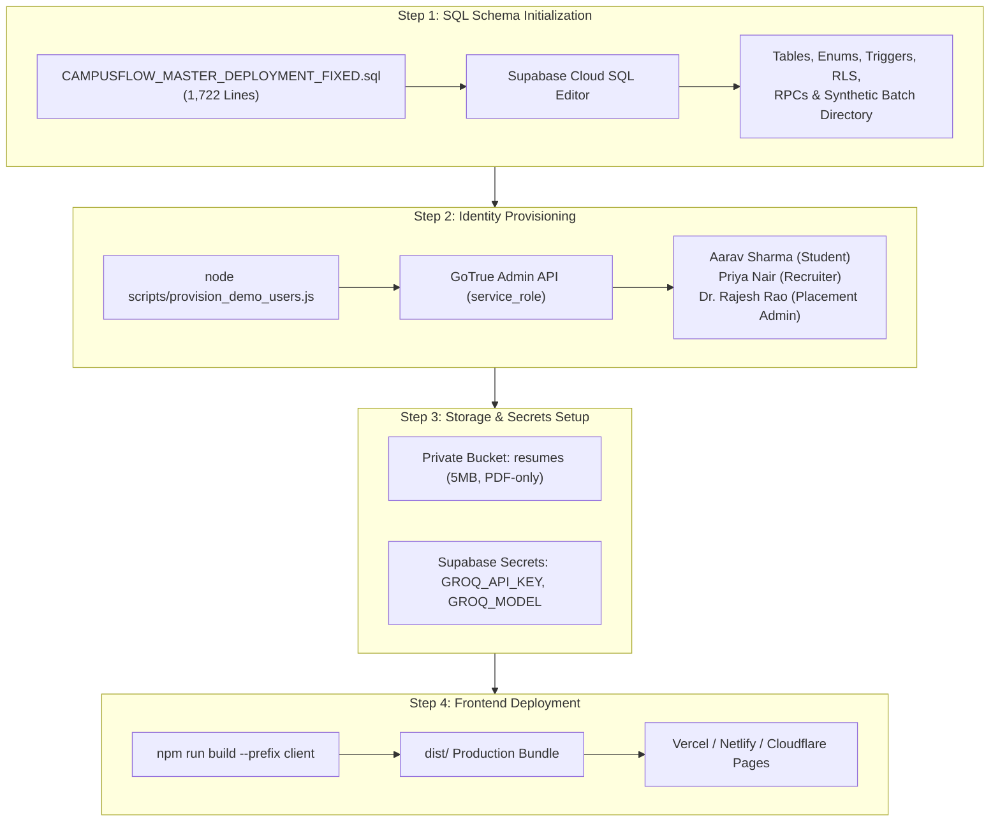

# CampusFlow — Supabase Deployment & Production Runbook

> **Target Cloud:** Supabase Cloud (PostgreSQL 15+, GoTrue v2, Supabase Storage, Edge Functions)  
> **Master SQL File:** `supabase/CAMPUSFLOW_MASTER_DEPLOYMENT_FIXED.sql` (1,722 lines)  
> **Identity Provisioning Script:** `scripts/provision_demo_users.js`

---

## 1. Deployment Architecture & Safe Separation

CampusFlow strictly decouples **Relational Schema & Business Logic Initialization** from **Authenticated Identity Provisioning**:



---

## 2. Step-by-Step Deployment Guide

### Phase 1: Database Migration Execution

1. Open your browser and navigate to the [Supabase Dashboard](https://supabase.com/dashboard).
2. Select your project and navigate to the **SQL Editor** (`/sql/new`).
3. Open `supabase/CAMPUSFLOW_MASTER_DEPLOYMENT_FIXED.sql` in your local code editor.
4. Copy the entire contents and paste into the Supabase SQL Editor query window.
5. Click **Run** (`Ctrl + Enter`).
6. Confirm the verification summary output:
   ```text
   status: "Deployment verification complete."
   companies_count: 6
   drives_count: 3
   jobs_count: 7
   students_count: 19
   applications_count: 16
   ```

> [!NOTE]
> The master script is **fully idempotent**. It uses `IF NOT EXISTS`, `ON CONFLICT DO NOTHING`, and safe drop-and-recreate patterns for stored functions and triggers. It is safe to re-run without duplicate key errors.

---

### Phase 2: Additional Migrations (V4.5 & V5 Features)

After Phase 1 completes, run the following supplementary feature migrations in the SQL Editor:

1. **Watchlist Migration:**
   - File: `supabase/migrations/20261031_student_watchlist.sql`
   - Creates `public.student_watchlists` table and RLS policies.
2. **Resume Intelligence & Recruiter Invitations:**
   - File: `supabase/migrations/20261031000001_resume_intelligence.sql`
   - Creates `public.resume_analyses` and `public.recruiter_invitations` tables and RLS policies.

---

### Phase 3: Authenticated Demo User Provisioning

Once the database tables are ready, provision the three evaluation accounts through the GoTrue Admin API:

1. Ensure `SUPABASE_SECRET_KEY` is present in your root `.env` file:
   ```env
   SUPABASE_URL=https://<your-project-id>.supabase.co
   SUPABASE_SECRET_KEY=eyJhbGciOi...
   ```
2. Execute the provisioning script:
   ```bash
   node scripts/provision_demo_users.js
   ```
3. The script automatically:
   - Registers and auto-confirms `aarav.sharma@campus.edu`, `priya.nair@novatech.io`, and `placements@campus.edu`.
   - Links Priya Nair to NovaTech Systems in `recruiter_company_memberships`.
   - Links Aarav Sharma to his verified student academic records (`N25H02A0325`, CGPA 8.85), technical skills, and applications.

---

### Phase 4: Storage Bucket Configuration

1. In Supabase Dashboard, go to **Storage** → **New Bucket**.
2. Name: `resumes`.
3. Set **Public Bucket** to `OFF` (Private).
4. Set **Maximum file size** to `5 MB`.
5. Set **Allowed MIME types** to `application/pdf`.
6. Confirm that the storage RLS policies declared in `20261030000002_row_level_security.sql` are active.

---

### Phase 5: Edge Function Deployment & Cloud Secrets

If deploying Supabase Edge Functions to Supabase Cloud:

1. Install Supabase CLI:
   ```bash
   npm install -g supabase
   ```
2. Link your project:
   ```bash
   supabase link --project-ref <your-project-id>
   ```
3. Set cloud secrets:
   ```bash
   supabase secrets set GROQ_API_KEY="your-groq-api-key"
   supabase secrets set GROQ_MODEL="openai/gpt-oss-120b"
   ```
4. Deploy functions:
   ```bash
   supabase functions deploy analyze-resume
   supabase functions deploy manage-recruiter
   ```

---

### Phase 6: Post-Deployment Verification Checklist

- [ ] Execute `node scripts/test_real_postgresql_execution.js` (Must pass with 0 errors).
- [ ] Execute `node tests/supabase_integration_test.js` (68 assertions must pass).
- [ ] Execute `node tests/e2e_recruitment_lifecycle.js` (11 steps must pass).
- [ ] Build client production bundle: `npm run build --prefix client` (Zero TypeScript errors).
- [ ] Log in with `aarav.sharma@campus.edu` and verify Student Workspace.
- [ ] Log in with `priya.nair@novatech.io` and verify Recruiter ATS Workspace.
- [ ] Log in with `placements@campus.edu` and verify Admin Command Center.
