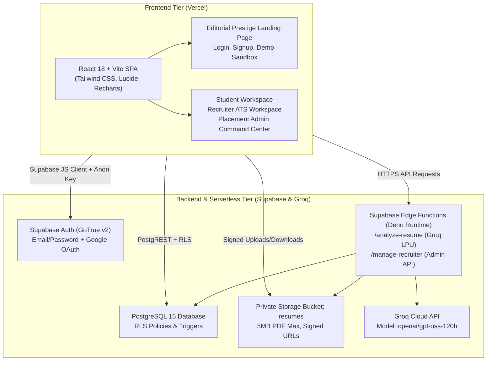

# CampusFlow — Complete Production Deployment Guide

> **Project:** CampusFlow — Institutional Campus Recruitment & Career Intelligence Platform  
> **Hackathon Reference:** HACK-P410  
> **Target Cloud:** Vercel (Frontend SPA) + Supabase Cloud (PostgreSQL 15+, GoTrue v2, Supabase Storage, Edge Functions) + Groq Cloud (LPU™ AI Engine)  
> **Master SQL File:** `supabase/CAMPUSFLOW_MASTER_DEPLOYMENT_FIXED.sql` (1,722 lines)  
> **Release Target:** Version 6.0 Production Release

---

## 1. Production Architecture Overview

CampusFlow uses an enterprise three-tier architecture:



---

## 2. Step-by-Step Production Deployment Guide

### Phase 1: Database Migration Execution

1. Open the [Supabase Cloud Dashboard](https://supabase.com/dashboard).
2. Select your project and navigate to the **SQL Editor** (`/sql/new`).
3. Open `supabase/CAMPUSFLOW_MASTER_DEPLOYMENT_FIXED.sql` in your editor.
4. Copy the entire contents and paste into the Supabase SQL Editor query window.
5. Click **Run** (`Ctrl + Enter`).
6. Confirm the verification output:
   ```text
   status: "Deployment verification complete."
   companies_count: 6
   drives_count: 3
   jobs_count: 7
   students_count: 19
   applications_count: 16
   ```

> [!NOTE]
> The master script is **fully idempotent**. It uses `IF NOT EXISTS`, `ON CONFLICT DO NOTHING`, and safe drop-and-recreate patterns for stored functions and triggers.

---

### Phase 2: Supplementary Feature Migrations

After Phase 1 completes, run the following supplementary feature migrations in the SQL Editor:

1. **Watchlist Migration:**
   - File: `supabase/migrations/20261031_student_watchlist.sql`
   - Creates `public.student_watchlists` table and RLS policies.
2. **Resume Intelligence & Recruiter Invitations:**
   - File: `supabase/migrations/20261031000001_resume_intelligence.sql`
   - Creates `public.resume_analyses` and `public.recruiter_invitations` tables and RLS policies.

---

### Phase 3: Identity & Demo Persona Provisioning

Provision the evaluation accounts through the GoTrue Admin API:

1. Ensure `SUPABASE_SECRET_KEY` is present in your root `.env` file:
   ```env
   SUPABASE_URL=https://<your-project-id>.supabase.co
   SUPABASE_SECRET_KEY=eyJhbGciOi...
   ```
2. Execute the provisioning script:
   ```bash
   node scripts/provision_demo_users.js
   ```
3. The script registers and auto-confirms:
   - `aarav.sharma@campus.edu` (Student: B.Tech CSE, 8.85 CGPA, 3 applications)
   - `priya.nair@novatech.io` (Recruiter: NovaTech Systems lead recruiter)
   - `placements@campus.edu` (Placement Admin: Dr. Rajesh Rao, Head of T&P)

---

### Phase 4: Private Storage Bucket Configuration

1. In the Supabase Dashboard, go to **Storage** → **New Bucket**.
2. Name: `resumes`.
3. Set **Public Bucket** to `OFF` (Private).
4. Set **Maximum file size** to `5 MB`.
5. Set **Allowed MIME types** to `application/pdf`.
6. Confirm that the storage RLS policies declared in `20261030000002_row_level_security.sql` are active.

---

### Phase 5: Supabase Edge Functions Deployment

Deploy the two serverless Deno edge functions to Supabase Cloud:

1. Install Supabase CLI:
   ```bash
   npm install -g supabase
   ```
2. Link your project:
   ```bash
   supabase link --project-ref <your-project-ref>
   ```
3. Register production secrets in the cloud vault:
   ```bash
   supabase secrets set GROQ_API_KEY="gsk_..."
   supabase secrets set GROQ_MODEL="openai/gpt-oss-120b"
   supabase secrets set SUPABASE_SERVICE_ROLE_KEY="eyJhbGciOi..."
   ```
4. Deploy functions:
   ```bash
   supabase functions deploy analyze-resume
   supabase functions deploy manage-recruiter
   ```

---

### Phase 6: Vercel Frontend Deployment

Deploy the client Single Page Application (SPA) to Vercel:

1. Connect your GitHub repository to Vercel.
2. In the deployment configuration:
   - **Framework Preset:** `Vite`
   - **Root Directory:** `client` (or root using `vercel.json`)
   - **Build Command:** `npm run build`
   - **Output Directory:** `dist`
3. Configure **Environment Variables** in Vercel:
   - `VITE_SUPABASE_URL` = `https://<your-project-id>.supabase.co`
   - `VITE_SUPABASE_ANON_KEY` = `<your-anon-key>`
   - `VITE_API_URL` = `https://<your-project-id>.supabase.co/functions/v1`
4. Deploy the project.
5. Verify deep-link routing: navigating directly to `/student/dashboard`, `/recruiter/jobs`, or `/demo` resolves correctly without 404 errors due to `vercel.json` rewrites.

---

### Phase 7: Google OAuth Configuration (Optional)

To enable 1-click Google Sign-In for real users:

1. In the [Google Cloud Console](https://console.cloud.google.com/apis/credentials):
   - Create an OAuth 2.0 Client ID for Web Applications.
   - Authorized Javascript Origins:
     - `https://<your-project-id>.supabase.co`
     - `https://<your-production-domain>.vercel.app`
   - Authorized Redirect URIs:
     - `https://<your-project-id>.supabase.co/auth/v1/callback`
2. In Supabase Dashboard → **Authentication** → **Providers** → **Google**:
   - Turn **ON** Google provider.
   - Enter **Client ID** and **Client Secret**.
   - Save.
3. In Supabase Dashboard → **Authentication** → **URL Configuration**:
   - Site URL: `https://<your-production-domain>.vercel.app`
   - Redirect URLs: `https://<your-production-domain>.vercel.app/auth/callback`

---

## 3. Post-Deployment Verification Commands

Run the complete automated validation suite:

```bash
# 1. Verify PostgreSQL Schema & Relations
node scripts/test_real_postgresql_execution.js

# 2. Deep Validation of RLS Policies
node scripts/validate_database_deep.js

# 3. Verify Real User Browser Isolation
node scripts/verify_real_user_browser.mjs

# 4. Verify Role Authorization Route Guards
node scripts/test_route_guard.mjs

# 5. Verify Groq Resume Intelligence
node scripts/verify_v5_resume_fix.mjs
```

All 5 verification suites must pass with zero errors before handing off the production deployment.
