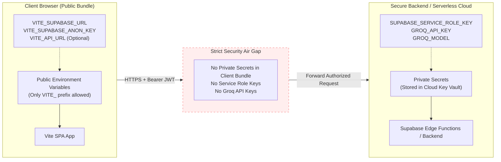

# CampusFlow — Production Environment Configuration Guide

> **Security Classification:** Confidential / Production Runbook  
> **Target Deployments:** Vercel (Frontend SPA) + Supabase Cloud (PostgreSQL, Auth, Storage, Edge Functions) + Groq Cloud (LPU™ Inference)  
> **Updated:** Version 6.0 (Production Release Readiness)

---

## 1. Security Architecture & Environment Separation

CampusFlow strictly enforces an **asymmetric environment model** to guarantee zero leakage of privileged credentials into public client bundles:



### Critical Rules
1. **Never prefix private keys with `VITE_`**: Vite automatically embeds every environment variable prefixed with `VITE_` directly into the minified public JavaScript bundle.
2. **`SUPABASE_SECRET_KEY` / `SUPABASE_SERVICE_ROLE_KEY`** has root bypass privileges over PostgreSQL Row Level Security (RLS). It must NEVER be committed to Git or added to client environment files.
3. **`GROQ_API_KEY`** grants access to the high-throughput Groq Cloud LPU™ inference engine. It must remain exclusively within the serverless runtime or backend daemon.

---

## 2. Environment Variables Catalog

### 2.1 Public Frontend Variables (Client SPA)

These variables are defined in `client/.env` (local) or configured in the **Vercel Project Settings → Environment Variables**:

| Variable Name | Required | Default / Example Value | Description |
| :--- | :---: | :--- | :--- |
| `VITE_SUPABASE_URL` | **Yes** | `https://apqkpvjelffpbjdkgtsz.supabase.co` | The unique HTTPS endpoint of your Supabase Cloud instance. |
| `VITE_SUPABASE_ANON_KEY` | **Yes** | `eyJhbGciOiJIUzI1NiIsInR5cCI6...` | The public anonymous API key for Supabase Auth, client database queries, and RLS. |
| `VITE_API_URL` | *Optional* | `https://<project-ref>.supabase.co/functions/v1` | Base URL for Edge Functions / Backend API. If empty, client defaults to `/functions/v1` (works with local proxy and Vercel rewrites). |
| `VITE_DEMO_PASSWORD` | *Optional* | `CampusFlow2026!` | Evaluation fallback password used on the `/demo` quick-login sandbox. |

### 2.2 Private Backend Secrets (Edge Functions & Local Server)

These variables are set in the root `.env` (local) or registered using `supabase secrets set` (Supabase Cloud Edge Functions):

| Secret Name | Required | Default / Example Value | Scope & Description |
| :--- | :---: | :--- | :--- |
| `SUPABASE_URL` | **Yes** | `https://apqkpvjelffpbjdkgtsz.supabase.co` | Supabase project API URL. |
| `SUPABASE_SERVICE_ROLE_KEY` | **Yes** | `eyJhbGciOiJIUzI1NiIsInR5cCI6...` | Supabase root administrative key. Used by `manage-recruiter` and `analyze-resume` to verify users, create recruiter auth records, and read private files. |
| `SUPABASE_SECRET_KEY` | *Alias* | `eyJhbGciOiJIUzI1NiIsInR5cCI6...` | Backward-compatible alias for `SUPABASE_SERVICE_ROLE_KEY`. |
| `GROQ_API_KEY` | **Yes** | `gsk_...` | Groq Cloud API Key for LPU™ accelerated resume analysis. |
| `GROQ_MODEL` | *Optional* | `openai/gpt-oss-120b` | Groq AI model name. High-reasoning open weights model. |
| `PORT` | *Optional* | `3001` | HTTP port for the local intelligence daemon proxy (`server/src/index.mjs`). |

---

## 3. Platform Setup Instructions

### 3.1 Local Development Environment

1. Copy `.env.example` to root `.env`:
   ```bash
   cp .env.example .env
   ```
2. Populate the required values:
   ```env
   VITE_SUPABASE_URL=https://<your-project-id>.supabase.co
   VITE_SUPABASE_ANON_KEY=<your-anon-key>
   SUPABASE_URL=https://<your-project-id>.supabase.co
   SUPABASE_SECRET_KEY=<your-service-role-key>
   GROQ_API_KEY=gsk_<your-groq-key>
   GROQ_MODEL=openai/gpt-oss-120b
   PORT=3001
   ```
3. Copy `client/.env.example` to `client/.env`:
   ```bash
   cp client/.env.example client/.env
   ```
4. Populate client public variables:
   ```env
   VITE_SUPABASE_URL=https://<your-project-id>.supabase.co
   VITE_SUPABASE_ANON_KEY=<your-anon-key>
   ```

### 3.2 Vercel Frontend Deployment

When deploying the frontend SPA to Vercel:

1. In the Vercel Project Settings, navigate to **Settings → Environment Variables**.
2. Add the following variables for **Production**, **Preview**, and **Development**:
   - `VITE_SUPABASE_URL` = `https://<your-project-id>.supabase.co`
   - `VITE_SUPABASE_ANON_KEY` = `<your-anon-key>`
   - `VITE_API_URL` = `https://<your-project-id>.supabase.co/functions/v1` (or your deployed backend proxy)
3. Set **Root Directory** to `client` (or use the root `vercel.json` rewrite configuration).
4. Set **Build Command** to `npm run build`.
5. Set **Output Directory** to `dist`.

### 3.3 Supabase Cloud Edge Functions Secrets

Deploy secrets to Supabase Cloud so the hosted Deno Edge Functions can access Groq and the Supabase Admin API:

```bash
# 1. Log in to Supabase CLI
supabase login

# 2. Link your CLI to your remote project
supabase link --project-ref <your-project-ref>

# 3. Securely set cloud secrets (these are stored in Vault, never exposed in client)
supabase secrets set GROQ_API_KEY="gsk_..."
supabase secrets set GROQ_MODEL="openai/gpt-oss-120b"
supabase secrets set SUPABASE_SERVICE_ROLE_KEY="eyJhbGciOi..."

# 4. Deploy the Edge Functions
supabase functions deploy analyze-resume
supabase functions deploy manage-recruiter
```

---

## 4. Verification & Secret Leak Prevention Checklist

Before initiating any build or Git commit, verify the following:

- [x] `.env`, `.env.local`, `client/.env`, `client/.env.local` are listed in `.gitignore`.
- [x] No `VITE_GROQ_API_KEY` exists in any codebase file.
- [x] No `VITE_SUPABASE_SECRET_KEY` or `VITE_SERVICE_ROLE_KEY` exists.
- [x] Client bundle inspection confirms zero occurrence of private keys in `dist/assets/*.js`.
- [x] All Supabase database operations rely on Row Level Security (RLS) for client access.
- [x] Administrative endpoints (`/functions/v1/manage-recruiter`) verify caller authorization (`role === 'placement_admin'`) before executing privileged actions.
