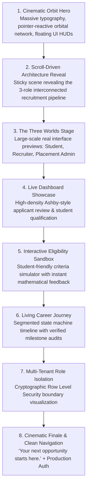

# CampusFlow V4 — Deep Audit of Installed Design Skills & Redesign Synthesis
## Impeccable × Emil Design Engineering × Anti-Slop Frontend Taste
### Hackathon Problem: HACK-P410 | Google Antigravity & GSD

---

## 1. Executive Summary & Root Cause Analysis

The initial landing page fell into the classic **"avoidance aesthetic" trap**: by systematically eliminating automated inspector errors (hairlines, gradients, emojis, monospace, kickers), the page lost visual richness and defaulted to a sparse, clinical, technical documentation layout:
- Repetitive rectangular boxes with identical dark fills.
- Small decorative orbital canvas trapped inside a small height constraint.
- Jargon-heavy engineering copy displaying raw database terms and PostgreSQL RPC names (`evaluate_job_eligibility()`).
- Static, card-heavy presentations that felt like docs rather than an Apple product launch reveal.
- Publicly visible demo role switcher and simulated mock sessions instead of authentic, production-grade Supabase authentication.

To satisfy the emergency redesign mandate, we performed a deep architectural audit of the three installed design skills:
1. `.agent/skills/impeccable/`
2. `.agents/skills/emil-design-eng/`
3. `.agents/skills/design-taste-frontend/`

---

## 2. In-Depth Skill-by-Skill Audit & Concrete Influences

### Skill 1: Impeccable Design System (`.agent/skills/impeccable/`)

#### Files Inspected:
- `SKILL.md` (Version 4.8.0, core tenets of Craft, Modes, and Ambition)
- `reference/craft-floor.md` (Quality floor, contrast, typography tracking, banning eyebrows, zero-offset halos)
- `reference/mode-persuade.md` (Persuade mode rules: opening must make the offer intelligible and desirable, expose an immediate action, and prove what only this product can prove)
- `reference/bolder.md` (Escaping timid layouts: bold scale steps, whole fields of color, dominant focal moves)
- `reference/craft.md` (Committing to an authentic visual world)

#### How Impeccable Influences the Redesign:
1. **Mode: Persuade**: The landing page is not an internal tool (`Operate`) or a changelog (`Read`); it is a high-stakes conversion and storytelling surface (`Persuade`). The hero scene must lead with a dominant visual spectacle and immediate, clear action (`Get Started` / `Sign In`), not a tiny widget tucked under three lines of text.
2. **Elimination of the "Generic Product Page Template"**: Impeccable explicitly bans the generic trope: *a headline over subcopy and a button with a row of equal cards below*. The redesign replaces repeated boxes with asymmetrical, full-bleed stages, editorial typography, and high-impact visual anchors.
3. **Typography & Measure Rules**:
   - Primary display scale up to $4.5\text{rem} - 5.5\text{rem}$ with tight tracking (`-0.035em`).
   - Body measure strictly bounded between 60ch–75ch for effortless scannability.
   - Contrast strictly $\ge 4.5:1$ on text, tinting secondary elements from the hue palette rather than washed-out gray.
4. **Browser Surface Craft**: Text selection, custom scrollbar styling, active button states, and tabular figures are custom-themed to the CampusFlow palette (`#0F766E`, `#72F4D1`, `#59D9FF`, `#060B12`).

---

### Skill 2: Emil Kowalski Design Engineering (`.agents/skills/emil-design-eng/`)

#### Files Inspected:
- `SKILL.md` (Complete 674-line design engineering philosophy)

#### How Emil's Philosophy Influences the Redesign:
1. **The Animation Decision Framework**:
   - Marketing and storytelling sequences: allowed to be expressive, cinematic, and narrative-driven.
   - Interactive UI elements (buttons, inputs, tabs): strictly $\le 250\text{ms}$ with punchy custom easings.
   - Built-in CSS easings (`ease-in`, generic `ease`) are prohibited. Use custom spring curves:
     ```css
     --ease-out: cubic-bezier(0.23, 1, 0.32, 1);
     --ease-in-out: cubic-bezier(0.77, 0, 0.175, 1);
     --ease-spring: cubic-bezier(0.16, 1, 0.3, 1);
     ```
2. **Tactile Interaction Physics**:
   - Every pressable element incorporates `active:scale-[0.97]` or `scale(0.95)` with 160ms ease-out, creating instantaneous tactile confirmation.
   - Never animate from `scale(0)`. Elements must enter from `scale(0.95)` with `opacity: 0` to feel organic.
3. **Seamless Stage Transitions with Blur**:
   - Switching between Student, Recruiter, and Admin stages uses a subtle crossfade blur (`filter: blur(2px)`) to mask visual swapping and eliminate layout flicker.
4. **Hardware Acceleration Mastery**:
   - All scroll-linked and continuous transforms are restricted strictly to `transform` (`translate3d`, `scale`, `rotate`) and `opacity`. Never animate `width`, `height`, `margin`, or `padding`.
5. **Reduced Motion Accessibility**:
   - Full support for `prefers-reduced-motion: reduce`, gracefully rendering static high-fidelity compositions without disorienting motion.

---

### Skill 3: Anti-Slop Frontend Taste (`.agents/skills/design-taste-frontend/`)

#### Files Inspected:
- `SKILL.md` (Analysis of 247 curated gallery sites)
- `references/scenes.md` (Sticky scroll scenes, GSAP scrub choreography, full-screen stage holds)
- `references/tells.md` (Comprehensive registry of AI-generated tropes)
- `references/copy.md` (Writing compelling product claims and evidence without buzzword soup)
- `references/motion.md` (Quiet layer vs. scene layer)

#### How Anti-Slop Taste Influences the Redesign:
1. **Sticky Scroll Scenes over Card Columns**:
   - Instead of scrolling past endless card boxes, the page introduces **cinematic scroll scenes** where the stage holds still (`position: sticky`) while scroll scrubs multi-layered visual transformations.
2. **Eradication of "AI Tells"**:
   - Banned: Centered headlines followed by three identical icon cards.
   - Banned: Kicker labels ("INTRODUCING", "FEATURES") above headlines.
   - Banned: Unearned multi-color gradient text and decorative neon glows.
   - Banned: Monospace text outside actual code blocks.
   - Banned: Thin hairline dividers carving up content into micro-boxes.
   - Banned: Emoji bullets (`✓`, `🚀`, `🔥`).
3. **The "Avoidance Aesthetic" Antidote**:
   - Stripping tells is only half the battle; the missing half is **substance**: massive typography, full-bleed color fields, real product interfaces at scale, and bold visual centerpieces.
4. **Copywriting Overhaul**:
   - Stripping internal developer jargon (PostgreSQL RPC names, CSS class discussions).
   - Replaced with clear, authoritative product copy addressing real student and recruiter aspirations.

---

## 3. The New Master Architectural Blueprint



---

## 4. Authentication Architecture & Demo Mode Isolation

### Public Surface vs. Demo Mode
- **Public Navigation**: Absolutely no demo mode toggle, role switcher, or simulated logins in the public header.
- **Header Actions**: Clean, industry-standard navigation: `CampusFlow` brand $\to$ `Platform`, `For Students`, `For Recruiters`, `Eligibility` $\to$ `Log In` and `Get Started` buttons.
- **Dedicated Authentication Routes**:
  - `/login`: Split-screen layout with an immersive CampusFlow visual graphic on the left, and an accessible, full-featured Supabase login form on the right (Email/Password + Google OAuth).
  - `/signup`: Real student registration flow creating strictly student records with password confirmation and terms acknowledgment.
  - `/forgot-password` & `/reset-password`: Standard password recovery flows.
- **Authoritative Database Routing**: Post-login role determination reads from `public.profiles` in Supabase; ordinary users cannot alter their role.
- **Controlled Demo Mode**: Relegated strictly to a hidden developer route (`/demo`) with prominent warnings, never interfering with public user authentication.
